# Лабораторная работа №3
## Дисциплина: Cloud Computing
## Работа с Amazon VPC
## Выполнил Студент: Бритков Егор, Informatica, I2402
## Выбраный уровень: Продвинутый, Вариант деплоя B
## Ссылка на публичный репозиторий: https://github.com/eredin-cloud/timecapsule.git 


## Задание 1. План адресов

Порядковый номер в группе: `k = 5`.

По формуле:

```text
X = k % 30 = 5
```

Диапазон VPC:

```text
10.5.0.0/16
```

| Подсеть | Зона доступности | Диапазон | Первый и последний адрес, доступный экземплярам | Сколько адресов доступно экземплярам |
|---|---|---|---|---:|
| `public-a` | `eu-central-1a` | `10.5.0.0/24` | `10.5.0.4` – `10.5.0.254` | 251 |
| `public-b` | `eu-central-1b` | `10.5.1.0/24` | `10.5.1.4` – `10.5.1.254` | 251 |
| `private-a` | `eu-central-1a` | `10.5.10.0/24` | `10.5.10.4` – `10.5.10.254` | 251 |
| `private-b` | `eu-central-1b` | `10.5.11.0/24` | `10.5.11.4` – `10.5.11.254` | 251 |

В каждой подсети `/24` всего 256 адресов, но AWS резервирует 5 адресов, поэтому экземплярам доступен 251 адрес.

Для подсети `10.5.0.0/24` AWS резервирует:

- `10.5.0.0` — адрес сети;
- `10.5.0.1` — виртуальный маршрутизатор VPC;
- `10.5.0.2` — DNS-сервер AWS;
- `10.5.0.3` — зарезервирован AWS для будущего использования;
- `10.5.0.255` — последний адрес подсети, зарезервирован AWS.

В VPC `/16` помещается 256 подсетей `/24`.

Так как в работе используются 4 подсети, остаётся:

```text
256 - 4 = 252
```

возможных подсети `/24`.

---

## Задание 2. VPC и подсети

Была создана собственная VPC:

```text
Name: timecapsule-dev-vpc
IPv4 CIDR: 10.5.0.0/16
Region: eu-central-1
```

Для VPC были включены параметры:

```text
Enable DNS resolution
Enable DNS hostnames
```

DNS resolution позволяет экземплярам внутри VPC использовать DNS-сервер AWS. DNS hostnames понадобится для работы с DNS-именами и приватной зоной Route 53 в следующих заданиях.

Внутри VPC были созданы четыре подсети в двух зонах доступности:

| Подсеть | Полное имя | Availability Zone | IPv4 CIDR |
|---|---|---|---|
| `public-a` | `timecapsule-dev-public-a` | `eu-central-1a` | `10.5.0.0/24` |
| `public-b` | `timecapsule-dev-public-b` | `eu-central-1b` | `10.5.1.0/24` |
| `private-a` | `timecapsule-dev-private-a` | `eu-central-1a` | `10.5.10.0/24` |
| `private-b` | `timecapsule-dev-private-b` | `eu-central-1b` | `10.5.11.0/24` |

Для созданных ресурсов использованы обязательные теги:

```text
Project = timecapsule
Environment = dev
Owner = Mishuna
Lab = lab3
```

После создания VPC AWS также автоматически создал основную таблицу маршрутов, Network ACL и Security Group по умолчанию.

Подсеть `public-a` на данном этапе ещё не является публичной. Название подсети не определяет её доступность из интернета. Для публичной подсети необходим маршрут `0.0.0.0/0` через Internet Gateway, который пока не создан и не настроен.

---

## Задание 3. Internet Gateway и таблицы маршрутов

Был создан Internet Gateway:

```text
timecapsule-dev-igw
```

и подключён к VPC:

```text
timecapsule-dev-vpc
```

После этого были созданы две таблицы маршрутов:

```text
timecapsule-dev-public-rt
timecapsule-dev-private-rt
```

Для публичной таблицы маршрутов был добавлен маршрут:

```text
0.0.0.0/0 → timecapsule-dev-igw
```

К `public-rt` были привязаны подсети:

```text
public-a
public-b
```

К `private-rt` были привязаны:

```text
private-a
private-b
```

В публичных подсетях была включена автоматическая выдача публичных IPv4-адресов.

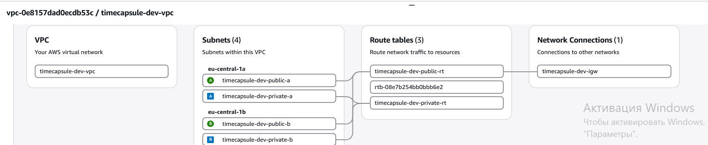

**Скриншот — Настроены таблицы маршрутов `public-rt` и `private-rt`, а также их связи с публичными и приватными подсетями.**

В обеих таблицах автоматически присутствует маршрут:

```text
10.5.0.0/16 → local
```

Он позволяет ресурсам внутри одной VPC обмениваться трафиком по приватным IP-адресам.

Если экземпляр из `private-a` отправит пакет на адрес `8.8.8.8`, пакет будет отброшен, потому что в `private-rt` нет маршрута `0.0.0.0/0` и, следовательно, нет пути во внешний интернет.

---

## Задание 4. Security Group

Для серверов были созданы три Security Group в VPC `timecapsule-dev-vpc`.

### bastion-sg

Полное имя:

```text
timecapsule-dev-bastion-sg
```

Входящее правило:

```text
SSH 22
Source: My IP
```

Группа разрешает подключение по SSH к bastion только с моего текущего публичного IP-адреса.

### web-sg

Полное имя:

```text
timecapsule-dev-web-sg
```

Входящие правила:

```text
HTTP 80
Source: 0.0.0.0/0
```

```text
SSH 22
Source: timecapsule-dev-bastion-sg
```

HTTP доступен из интернета, а SSH к веб-серверу разрешён только через bastion.

### db-sg

Полное имя:

```text
timecapsule-dev-db-sg
```

Входящие правила:

```text
PostgreSQL 5432
Source: timecapsule-dev-web-sg
```

```text
SSH 22
Source: timecapsule-dev-bastion-sg
```

Таким образом, к PostgreSQL может подключаться только сервер с группой `web-sg`, а SSH-доступ к серверу базы разрешён только через bastion.

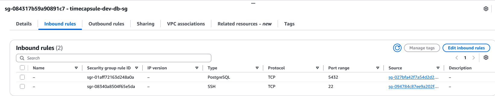
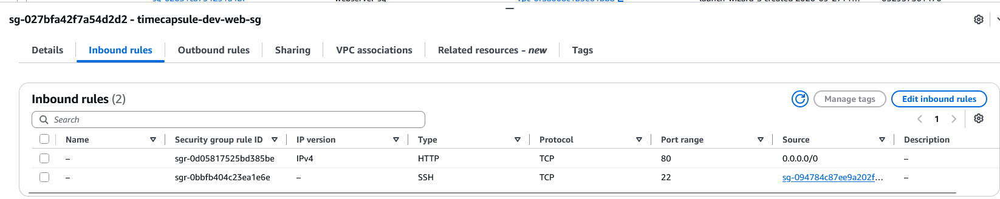
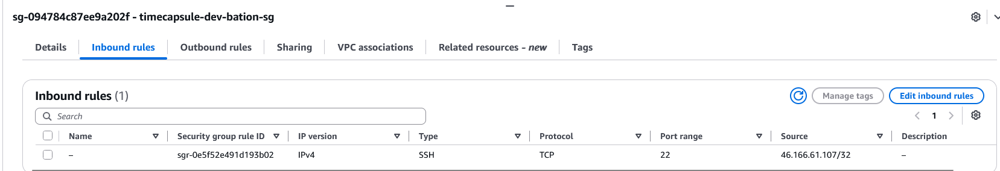

**Скриншот — Входящие правила трёх Security Group: `bastion-sg`, `web-sg` и `db-sg`.**

В `db-sg` источником для PostgreSQL указана Security Group `web-sg`, а не конкретный IP-адрес. Это позволяет разрешить доступ только экземплярам с нужной ролью и не зависит от изменения их IP-адресов.

Использование диапазона `10.5.0.0/16` было бы менее безопасным, так как доступ к базе получили бы все ресурсы внутри VPC, а не только веб-сервер.

---

## Задание 5. Экземпляры

В созданной VPC были запущены три экземпляра EC2:

| Роль | Имя | Подсеть | Публичный IP | Security Group |
|---|---|---|---|---|
| `bastion` | `timecapsule-dev-bastion` | `public-b` | Enable | `timecapsule-dev-bastion-sg` |
| `web-server` | `timecapsule-dev-web` | `public-a` | Enable | `timecapsule-dev-web-sg` |
| `db-server` | `timecapsule-dev-db` | `private-a` | Disable | `timecapsule-dev-db-sg` |

Все экземпляры используют Amazon Linux 2023, тип `t3.micro` и SSH-ключ из предыдущей лабораторной работы.

Для `web-server` при запуске был использован `User data`:

```bash
#!/bin/bash
dnf -y install nginx
echo "<h1>$(hostname)</h1><p>$(hostname -I)</p>" > /usr/share/nginx/html/index.html
systemctl enable --now nginx
```

После запуска страница nginx стала доступна по публичному IP веб-сервера. На ней отображаются имя сервера и его приватный IP-адрес из диапазона `10.5.0.0/24`.


**Скриншот — Страница `web-server`, на которой отображаются hostname и приватный IP-адрес экземпляра.**

Для администрирования серверов используется отдельный bastion. В локальном SSH config были описаны подключения `bastion`, `web` и `db`. Для `web` и `db` используется параметр:

```text
ProxyJump bastion
```

Таким образом, подключение к внутренним серверам сначала проходит через bastion, а приватный SSH-ключ остаётся на локальном компьютере и не копируется на сервер.

Подключения были проверены командами:

```bash
ssh bastion
ssh web
ssh db
```

После подключения к `db-server` была предпринята попытка установить PostgreSQL:

```bash
sudo dnf -y install postgresql16-server
```

Установка не завершилась, потому что `db-server` находится в приватной подсети и не имеет маршрута во внешний интернет.

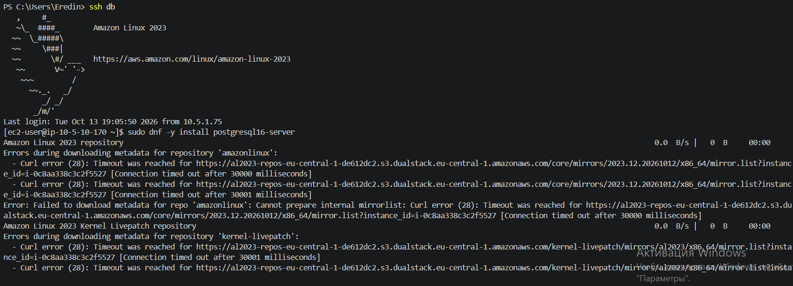

**Скриншот — `db-server` не может скачать пакет PostgreSQL из-за отсутствия выхода в интернет.**

`web-server` может скачивать пакеты, потому что находится в публичной подсети, имеет публичный IPv4-адрес и маршрут `0.0.0.0/0` через Internet Gateway.

`db-server` находится в `private-a`, не имеет публичного IP и использует таблицу `private-rt`, в которой отсутствует маршрут во внешний интернет.

Чтобы разрешить приватному серверу инициировать исходящие соединения с интернетом и при этом не делать его доступным из интернета, необходимо использовать NAT Gateway в публичной подсети и добавить в `private-rt` маршрут `0.0.0.0/0` через этот NAT Gateway.

---

## Задание 6. Временный NAT Gateway

Для временного доступа `db-server` в интернет был создан NAT Gateway:

```text
timecapsule-dev-nat-a
```

Он был размещён в публичной подсети:

```text
timecapsule-dev-public-a
```

и получил отдельный Elastic IP:

```text
timecapsule-dev-nat-a-eip
```

В таблицу маршрутов `private-rt` был временно добавлен маршрут:

```text
0.0.0.0/0 → timecapsule-dev-nat-a
```

После этого на `db-server` был проверен внешний IP:

```bash
curl https://checkip.amazonaws.com
```

Команда вернула Elastic IP NAT Gateway.

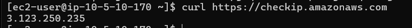

**Скриншот — `db-server` выходит в интернет через Elastic IP NAT Gateway.**

Это не адрес самого `db-server`, потому что у сервера нет публичного IPv4. NAT Gateway заменяет приватный адрес сервера своим внешним Elastic IP.

После появления выхода в интернет были установлены обновления и PostgreSQL:

```bash
sudo dnf -y update
sudo dnf -y install postgresql16-server
```

PostgreSQL был инициализирован:

```bash
sudo postgresql-setup --initdb
```

В `postgresql.conf` было разрешено прослушивание сетевых интерфейсов:

```text
listen_addresses = '*'
```

В `pg_hba.conf` было добавлено правило:

```text
host  all  all  10.5.0.0/24  scram-sha-256
```

После этого PostgreSQL был запущен и добавлен в автозапуск:

```bash
sudo systemctl enable --now postgresql
```

Также были созданы тестовый пользователь и база данных:

```text
User: student
Database: lab3
```

Доступ к базе ограничивают три уровня.

1. `db-server` не имеет публичного IP и прямого маршрута через Internet Gateway.
2. Security Group `db-sg` разрешает порт PostgreSQL `5432` только для `web-sg`.
3. `pg_hba.conf` PostgreSQL дополнительно разрешает подключения только из подсети `10.5.0.0/24` с парольной аутентификацией `scram-sha-256`.

Если ошибиться в одном уровне, другой механизм всё ещё может заблокировать нежелательное соединение. Однако слишком широкая настройка любого из уровней снижает общую безопасность.

После установки пакетов NAT Gateway был удалён.

После удаления маршрут:

```text
0.0.0.0/0
```

в таблице `private-rt` перешёл в состояние:

```text
Blackhole
```

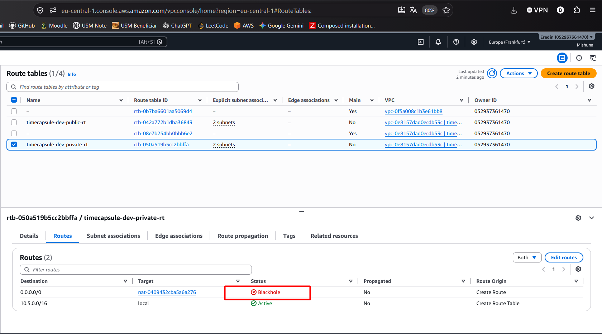
**Скриншот — После удаления NAT Gateway маршрут в `private-rt` находится в состоянии `Blackhole`.**

Удалённый NAT Gateway некоторое время остаётся видимым в списке со статусом `Deleted`.

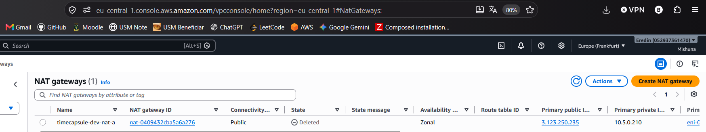

**Скриншот — NAT Gateway `timecapsule-dev-nat-a` после удаления отображается со статусом `Deleted`.**

После этого маршрут `0.0.0.0/0` был удалён из `private-rt`, а Elastic IP NAT Gateway был освобождён.

PostgreSQL продолжает работать после удаления NAT Gateway, потому что NAT нужен только для исходящих соединений в интернет. Соединения между `web-server` и `db-server` проходят внутри VPC по локальному маршруту `10.5.0.0/16 → local`.

Если в будущем на `db-server` понадобится установить обновления безопасности, NAT Gateway необходимо будет снова временно создать, добавить маршрут через него, выполнить обновление и затем удалить его.

---

## Задание 7. Проверки

Для проверки доступа к PostgreSQL с `web-server` был установлен клиент:

```bash
sudo dnf -y install postgresql16
```

После этого выполнено подключение к базе данных на `db-server`:

```bash
psql -h 10.5.10.170 -U student -d lab3 -c "SELECT version();"
```

Команда запросила пароль пользователя `student` и успешно вывела версию PostgreSQL.

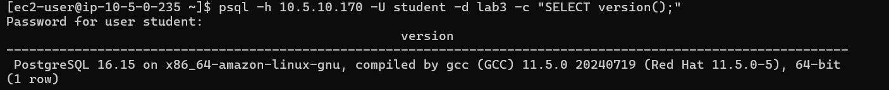

**Скриншот — Успешное подключение к PostgreSQL с `web-server`.**

Доступность порта PostgreSQL была проверена командой:

```bash
timeout 5 bash -c '</dev/tcp/10.5.10.170/5432' && echo open || echo closed
```

С `web-server` порт оказался открыт:

```text
open
```

С `bastion` тот же порт оказался закрыт:

```text
closed
```

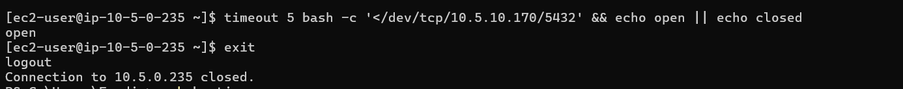

**Скриншот — Порт `5432` доступен с `web-server`, но недоступен с `bastion`.**

Причина в Security Group `db-sg`: для PostgreSQL разрешён источник `web-sg`, а не вся VPC. Поэтому наличие маршрута между серверами ещё не означает, что соединение будет разрешено Security Group.

С `db-server` была выполнена команда:

```bash
curl -m 5 https://github.com
```

Запрос завершился ошибкой соединения, потому что после удаления NAT Gateway в таблице `private-rt` больше нет маршрута `0.0.0.0/0`.

Подключиться к PostgreSQL на `db-server` напрямую из интернета нельзя. `db-server` не имеет публичного IP-адреса, приватная подсеть не имеет маршрута через Internet Gateway, `db-sg` разрешает порт `5432` только для `web-sg`, а PostgreSQL дополнительно ограничивает подключения через `pg_hba.conf`.

Для проверки Network ACL в default NACL нашей VPC было добавлено правило:

```text
Rule number: 90
Type: All traffic
Source: <мой публичный IP>/32
Action: Deny
```

После добавления этого правила с моего компьютера перестали работать и SSH-подключение к `bastion`, и доступ к сайту `web-server`.

При этом с телефона через мобильный интернет сайт продолжал открываться, потому что телефон использует другой внешний IP-адрес и правило `/32` на него не распространяется.

Network ACL фильтрует трафик на уровне подсети ещё до Security Group. Поэтому блокировка сработала без изменения правил Security Group.

Номер правила `90` выбран меньше `100`, потому что правила Network ACL обрабатываются по возрастанию номера, и применяется первое совпавшее правило. После проверки правило `90` было удалено.

Для проверки тегов был открыт:

```text
Resource Groups & Tag Editor → Tag Editor
```

Был выполнен поиск по параметрам:

```text
Region: eu-central-1
Resource types: All supported resource types
Project = timecapsule
```

В списке были проверены VPC, подсети, Internet Gateway, таблицы маршрутов, Security Group, экземпляры EC2 и их EBS-тома.

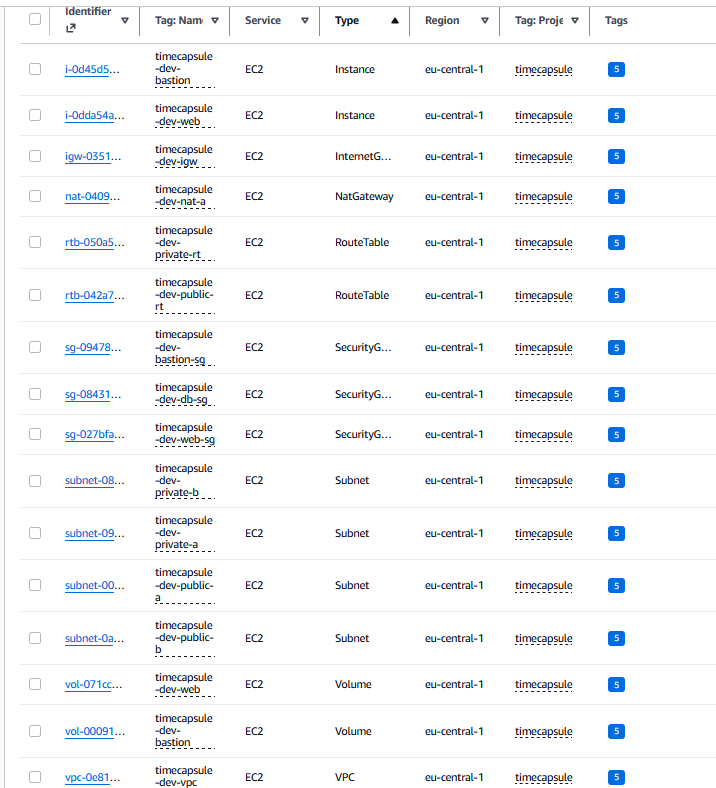

**Скриншот — Ресурсы проекта, найденные в Tag Editor по тегу `Project = timecapsule`.**

Тег `Project` позволяет быстро найти все ресурсы, относящиеся к одному проекту, например перед их удалением после завершения работы.

Тег `Owner` показывает, кто отвечает за конкретный ресурс. Даже в личном аккаунте этот тег полезен как часть единого соглашения по именованию и подготовка к работе в общих AWS-аккаунтах.

После завершения проверок экземпляры:

```text
timecapsule-dev-bastion
timecapsule-dev-web
timecapsule-dev-db
```

были остановлены через:

```text
Instance state → Stop instance
```

---

## Задание 8. Перенос сервера ЛР2 в новую сеть

Были запущены `bastion`, `db-server` и старый экземпляр `webserver` из ЛР2. После изменения публичного IP bastion адрес был обновлён в локальном SSH config.

Работа приложения TimeCapsule на старом `webserver` была проверена через браузер.

Из экземпляра ЛР2 был создан образ:

```text
timecapsule-dev-app-lab2
```

Для образа и его snapshot были добавлены обязательные теги:

```text
Project = timecapsule
Environment = dev
Owner = Mishuna
Lab = lab3
```

После перехода AMI в состояние `Available` из него был запущен новый экземпляр:

```text
timecapsule-dev-app
```

Экземпляр был размещён в:

```text
VPC: timecapsule-dev-vpc
Subnet: public-a
Security Group: timecapsule-dev-web-sg
```

User data не использовался, потому что все необходимые программы и приложение уже находились в созданном образе.

Для подключения к `app-server` в SSH config была добавлена запись с его приватным IP и использованием:

```text
ProxyJump bastion
```

После этого подключение было проверено командой:

```bash
ssh app
```

Временный экземпляр `timecapsule-dev-web`, созданный в Части 1, был завершён, так как его роль теперь выполняет `timecapsule-dev-app`.

AMI содержит снимок EBS-диска старого экземпляра и позволяет запустить новый сервер с тем же содержимым. Поэтому на `app-server` без повторной установки оказались операционная система, nginx, PHP-FPM, Composer, код TimeCapsule, зависимости, конфигурационные файлы, `.env`, PostgreSQL и данные приложения, находившиеся на диске старого сервера.

На данном этапе база данных TimeCapsule всё ещё находится локально на `app-server`, так как он является копией сервера ЛР2, где приложение и PostgreSQL работали на одном экземпляре. Отдельный `db-server` уже подготовлен, но перенос реальной базы приложения на него будет выполнен в следующих заданиях.

---

## Задание 9. Elastic IP

Для `app-server` был выделен постоянный публичный IPv4-адрес — Elastic IP.

Для адреса были заданы теги:

```text
Name = timecapsule-dev-app-eip
Project = timecapsule
Environment = dev
Owner = Mishuna
Lab = lab3
```

Elastic IP был связан с экземпляром:

```text
timecapsule-dev-app
```

После привязки автоматически назначенный публичный IPv4 экземпляра был заменён постоянным Elastic IP.

На `app-server` в файле:

```text
/var/www/timecapsule/.env
```

значение `APP_URL` было изменено на:

```env
APP_URL=http://<Elastic-IP>
```

После изменения конфигурации PHP-FPM был перезагружен:

```bash
sudo systemctl reload php-fpm
```

Приложение TimeCapsule было успешно открыто в браузере по постоянному Elastic IP, также была проверена авторизация под пользователем из ЛР2.

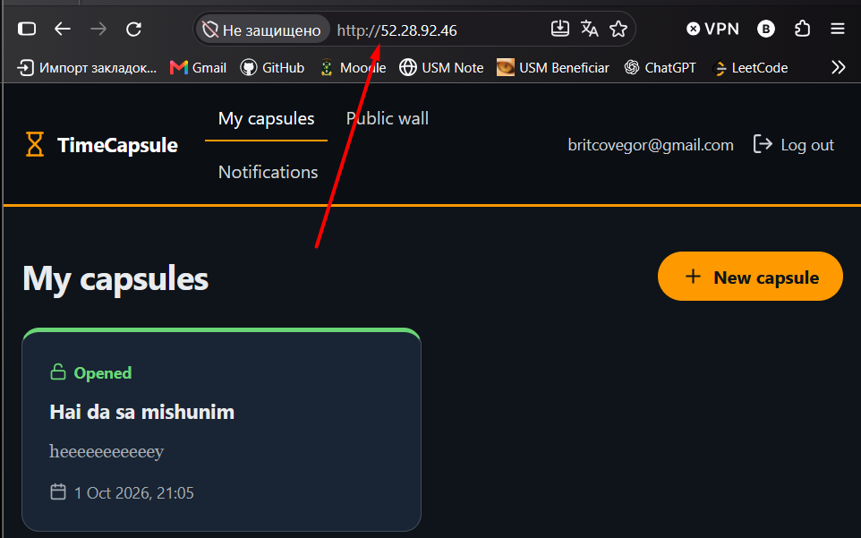

**Скриншот — Приложение TimeCapsule доступно через постоянный Elastic IP `app-server`.**

Elastic IP нужен `app-server`, потому что адрес приложения должен оставаться постоянным после остановки и повторного запуска EC2. Иначе пришлось бы каждый раз изменять `APP_URL` и использовать новый адрес в браузере.

Для `bastion` постоянный адрес не обязателен: он используется только для административного SSH-доступа, поэтому после запуска достаточно обновить его Public IPv4 в локальном SSH config.

AWS взимает плату за публичные IPv4-адреса, включая Elastic IP. Стоимость составляет примерно `$0.005` в час за адрес, в том числе когда связанный экземпляр остановлен, поскольку адрес остаётся выделенным аккаунту.

При появлении Load Balancer отдельный Elastic IP для `app-server` обычно больше не понадобится: пользователи будут обращаться к балансировщику, а сервер приложения сможет работать за ним без собственного постоянного публичного IPv4.

---

## Задание 10. База данных приложения на `db-server`

На `db-server` был создан отдельный пользователь PostgreSQL для приложения TimeCapsule:

```text
timecapsule
```

и отдельная база данных:

```text
timecapsule
```

База принадлежит пользователю `timecapsule`.

Для подключения был задан новый пароль, отличный от использовавшегося в ЛР2.

В файле:

```text
/var/lib/pgsql/data/pg_hba.conf
```

общее правило:

```text
host  all  all  10.5.0.0/24  scram-sha-256
```

было заменено на более строгое:

```text
host  timecapsule  timecapsule  10.5.0.0/24  scram-sha-256
```

Теперь из подсети `public-a` к базе может подключаться только пользователь `timecapsule` и только к базе `timecapsule`.

После изменения конфигурации PostgreSQL был перезапущен:

```bash
sudo systemctl restart postgresql
```

Новый сильный пароль нужен даже при закрытом порте 5432, потому что Security Group является только одним уровнем защиты. Дополнительно доступ ограничивают `pg_hba.conf` и пароль PostgreSQL. Если один из сетевых механизмов будет настроен неправильно или скомпрометирован доверенный сервер, пароль останется дополнительным барьером.

--

## Задание 11. Приватная зона Route 53

Для базы данных была создана приватная Hosted Zone Route 53:

```text
timecapsule.internal
```

Тип зоны:

```text
Private hosted zone
```

Зона была связана с:

```text
Region: eu-central-1
VPC: timecapsule-dev-vpc
```

В зоне была создана A-запись:

```text
db.timecapsule.internal
```

которая указывает на приватный IPv4-адрес `db-server`.

Параметры записи:

```text
Record name: db
Record type: A
Value: <private IP db-server>
TTL: 60
```

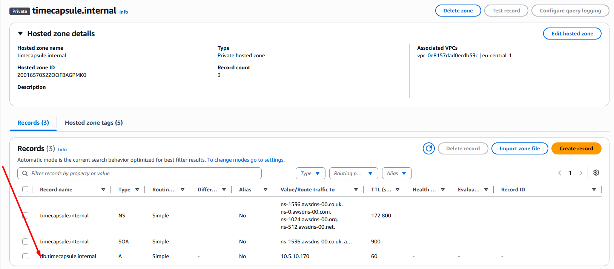

**Скриншот — A-запись `db.timecapsule.internal` в приватной зоне Route 53.**

С `app-server` имя было проверено командой:

```bash
dig +short db.timecapsule.internal
```

Команда вернула приватный IP `db-server`.

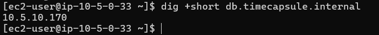
**Скриншот — Имя `db.timecapsule.internal` успешно разрешается внутри VPC.**

На локальном Windows-компьютере была выполнена команда:

```powershell
nslookup db.timecapsule.internal
```

Имя не разрешилось.

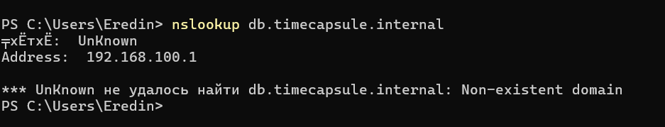

**Скриншот — Приватное имя базы не разрешается за пределами VPC.**

С `app-server` имя находится, потому что Private Hosted Zone связана с `timecapsule-dev-vpc`, и DNS-записи этой зоны доступны только ресурсам внутри этой VPC.

Локальный компьютер находится вне VPC и использует обычный DNS, поэтому имя `db.timecapsule.internal` ему неизвестно.

Если `db-server` будет пересоздан и получит новый приватный IP, достаточно изменить значение A-записи `db.timecapsule.internal` в Route 53. Конфигурацию приложения менять не потребуется.

---

## Задание 12. Перенос данных и переключение приложения

На `app-server` была выполнена выгрузка локальной базы данных TimeCapsule:

```bash
pg_dump -h localhost -U timecapsule -d timecapsule -f timecapsule.sql
```

В результате был создан SQL-дамп:

```text
timecapsule.sql
```

После этого данные были загружены в новую базу PostgreSQL на `db-server` по приватному DNS-имени:

```bash
psql -h db.timecapsule.internal -U timecapsule -d timecapsule -f timecapsule.sql
```

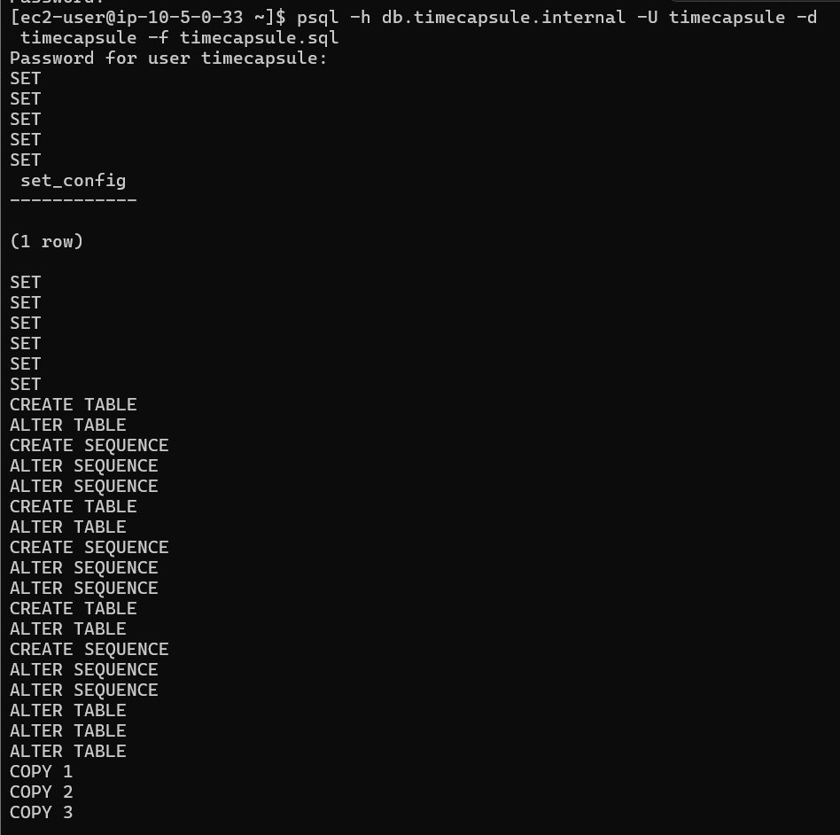

**Скриншот — Данные из старой базы успешно импортированы в PostgreSQL на `db-server`.**

В файле:

```text
/var/www/timecapsule/.env
```

настройки базы были изменены с локального подключения:

```env
DB_HOST=localhost
```

на:

```env
DB_HOST=db.timecapsule.internal
```

Также был установлен новый пароль пользователя базы данных.

После изменения настроек PHP-FPM был перезагружен:

```bash
sudo systemctl reload php-fpm
```

Чтобы убедиться, что приложение больше не использует локальную базу, PostgreSQL на `app-server` был остановлен и отключён из автозапуска:

```bash
sudo systemctl disable --now postgresql
```

После этого endpoint:

```text
/health
```

продолжил возвращать успешный статус базы данных.

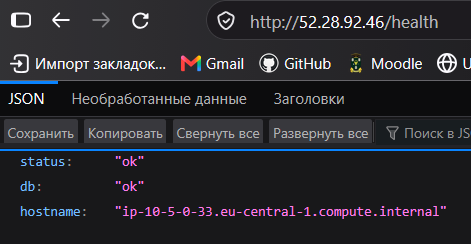

**Скриншот — Приложение успешно работает с удалённой базой на `db-server`.**

На главной странице также сохранились пользователь и капсулы, созданные в ЛР2.

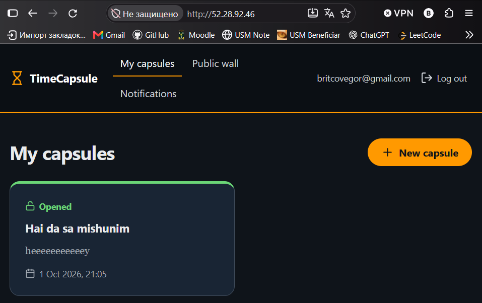

**Скриншот — После переноса базы старые данные TimeCapsule сохранились.**

После успешной проверки AMI:

```text
timecapsule-dev-app-lab2
```

был deregistered, а связанный с ним snapshot удалён.

Пользовательские файлы не переносились через `pg_dump`, потому что они находятся не в PostgreSQL, а на файловой системе `app-server`, в каталоге приложения `storage`.

Они попали на новый сервер вместе с AMI и EBS-диском. Если `app-server` удалить вместе с его EBS-томом, эти файлы будут потеряны, поэтому в более надёжной архитектуре их следует хранить во внешнем постоянном хранилище.

---

## Задание 13. Деплой и обслуживание

### Новая версия приложения

В интерфейс TimeCapsule было внесено заметное изменение — в подвал страницы добавлена строка:

```text
LR3
```

Изменение было сохранено в Git и отправлено в GitHub:

```bash
git add views/layout.php
git commit -m "Add LR3 footer"
git push
```

После этого новая версия была развёрнута на `app-server` удалённой командой:

```bash
ssh app ./deploy.sh
```

Несмотря на перенос приложения в новую VPC, изменять `deploy.sh` не пришлось. Скрипт по-прежнему получает код из GitHub, устанавливает зависимости, обновляет структуру базы данных и перезагружает PHP-FPM. Изменился только путь SSH-доступа к серверу: теперь соединение проходит через bastion с помощью `ProxyJump`.

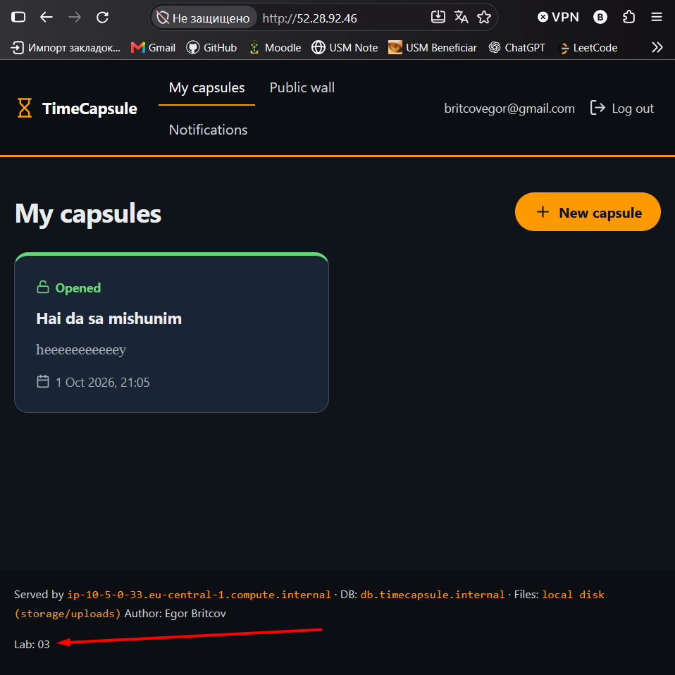

**Скриншот — Новая версия TimeCapsule с изменением `LR3`.**

### Проверка отказа базы данных

Для проверки поведения приложения при недоступной базе экземпляр:

```text
timecapsule-dev-db
```

был остановлен.

После этого `/health` перестал сообщать нормальное состояние базы данных, а запросы приложения, требующие PostgreSQL, завершались ошибкой или ожидали истечения таймаута соединения.

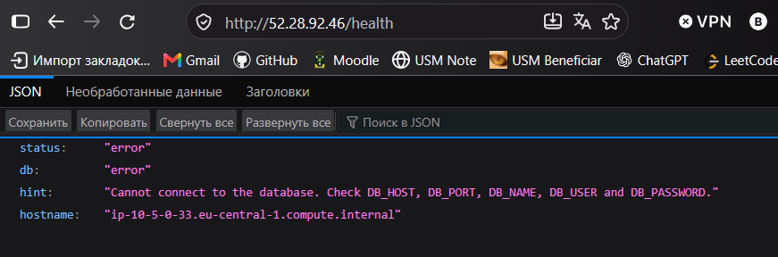
**Скриншот — Результат `/health` при остановленном `db-server`.**

После повторного запуска `db-server` приложение снова заработало без каких-либо изменений на `app-server`.

Основной приватный IPv4 экземпляра после `Stop → Start` сохранился, поэтому запись:

```text
db.timecapsule.internal
```

по-прежнему указывала на правильный сервер.

### Временный NAT Gateway для обновления сервера

Для автоматического создания и удаления временного NAT Gateway были созданы два скрипта:

```text
scripts/nat-up.sh
scripts/nat-down.sh
```

`nat-up.sh` выполняет:

1. выделение Elastic IP;
2. создание NAT Gateway в `public-a`;
3. ожидание состояния `Available`;
4. создание маршрута `0.0.0.0/0` через NAT Gateway в `private-rt`;
5. сохранение ID созданных ресурсов во временный state-файл.

Для NAT Gateway и Elastic IP используются обязательные теги:

```text
Project = timecapsule
Environment = dev
Owner = Eredin1272
Lab = lab3
```

Временный файл состояния:

```text
scripts/.nat-state
```

добавлен в `.gitignore`.

Скрипт создания NAT Gateway был запущен:

```bash
./scripts/nat-up.sh
```

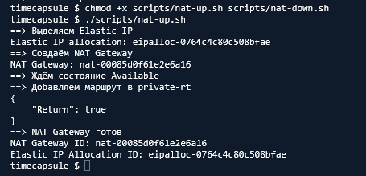

**Скриншот — Автоматическое создание временного NAT Gateway скриптом `nat-up.sh`.**

После появления выхода в интернет на `db-server` были установлены обновления:

```bash
sudo dnf -y update
```

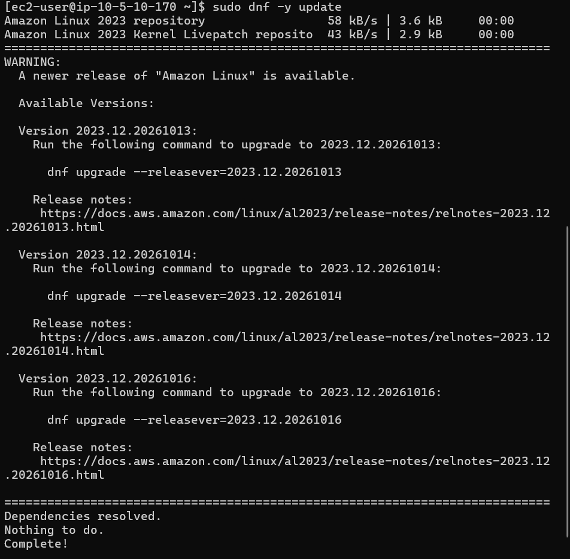

**Скриншот — Установка обновлений на `db-server` через временный NAT Gateway.**

После завершения обновления был выполнен:

```bash
./scripts/nat-down.sh
```

Скрипт удаляет маршрут, удаляет NAT Gateway, ждёт полного удаления шлюза и после этого освобождает Elastic IP.

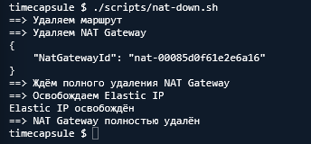

**Скриншот — Удаление временного NAT Gateway и освобождение Elastic IP скриптом `nat-down.sh`.**

Elastic IP необходимо освобождать только после полного удаления NAT Gateway, потому что до этого адрес остаётся связан со шлюзом и AWS не позволяет его освободить. Поэтому `nat-down.sh` сначала ждёт состояния удаления NAT Gateway и только после этого выполняет `release-address`.

---

## Задание 14. Архитектура и решение
Ниже представлена схема

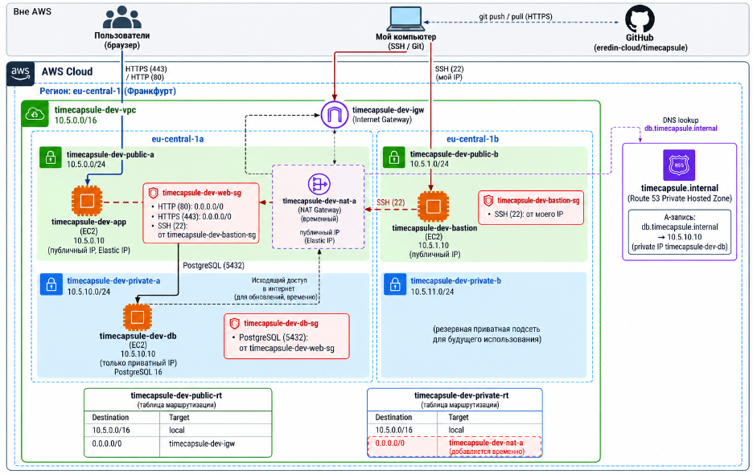

А также ссылка на ADR-файл который описывает архитектурное решение:

[ADR-0002](./adr/0002-database-placement.md)

---

## Завершение работы

После выполнения лабораторной работы старая EC2-машина `webserver` из ЛР2 была завершена (`Terminate`), поскольку приложение и данные были перенесены в новую архитектуру внутри `timecapsule-dev-vpc`.

Следующие экземпляры были остановлены:

```text
timecapsule-dev-bastion
timecapsule-dev-app
timecapsule-dev-db
```

В разделе `NAT gateways` было проверено отсутствие шлюзов в состоянии:

```text
Available
```

Временный NAT Gateway, использовавшийся для обновления `db-server`, был удалён.

В разделе `Elastic IPs` остался только постоянный адрес приложения:

```text
timecapsule-dev-app-eip
```

Elastic IP временного NAT Gateway был освобождён после удаления NAT Gateway.

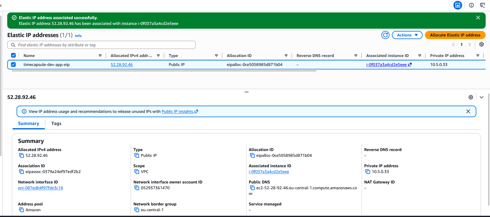

**Скриншот — После завершения работы остался только Elastic IP `app-server`.**

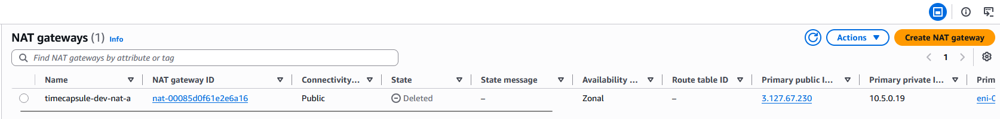

**Скриншот — После завершения работы нет NAT Gateway в состоянии `Available`.**

VPC, подсети, таблицы маршрутизации и Security Groups не удалялись, поскольку они не требуют отдельной оплаты и будут использоваться в следующих лабораторных работах.

Bastion используется только для административного SSH-доступа. Пока работа с серверами не требуется, его можно держать остановленным. При необходимости полностью убрать расходы на его EBS-диск bastion можно завершить и позже создать новый экземпляр с теми же сетевыми настройками.

---

## Контрольные вопросы
1. Запрос пользователя приходит из браузера на Elastic IP app-server через Internet Gateway и публичную подсеть public-a; входящий HTTP/HTTPS-трафик проверяет Security Group приложения. Затем app-server обращается к db-server по имени db.timecapsule.internal, трафик идёт внутри VPC по маршруту local, а на стороне базы его фильтруют Security Group, pg_hba.conf и аутентификация PostgreSQL.

2. Одного знания приватного IP недостаточно, потому что адрес db-server недоступен напрямую из интернета. Злоумышленнику нужен доступ внутрь VPC или к доверенному ресурсу, например app-server, а затем ещё нужно пройти Security Group и знать учётные данные PostgreSQL.

3. Временный NAT Gateway дешевле постоянного, потому что оплачивается только на время, когда приватному серверу действительно нужен выход в интернет, например для обновлений. Неудобство в том, что его каждый раз нужно создавать, ждать состояния Available, добавлять маршрут, а после работы удалять и освобождать Elastic IP.

4. Чтобы приложение переживало отказ eu-central-1a, нужно разместить ресурсы ещё и во второй зоне доступности, например app-server в public-b и базу/реплику в private-b. Также понадобится Load Balancer перед приложением и механизм высокой доступности базы, например репликация или managed database с Multi-AZ.

---
