# Лабораторная работа №4
## Дисциплина: Cloud Computing
## Работа с Amazon S3
## Выполнил Студент: Бритков Егор, Informatica, I2402
## Выбраный уровень: Продвинутый, Вариант деплоя B
## Ссылка на публичный репозиторий: https://github.com/eredin-cloud/timecapsule.git 

## Задание 1. Бакет и объекты в консоли

Создан бакет:

```text
timecapsule-dev-uploads-Eredin1272
```

Параметры: `General purpose`, `ACLs disabled`, `Block all public access`, `SSE-S3`, версионирование выключено.

Созданы префиксы:

```text
uploads/
backups/
```

В `uploads` загружены изображение и PDF, в `backups` — текстовый файл.

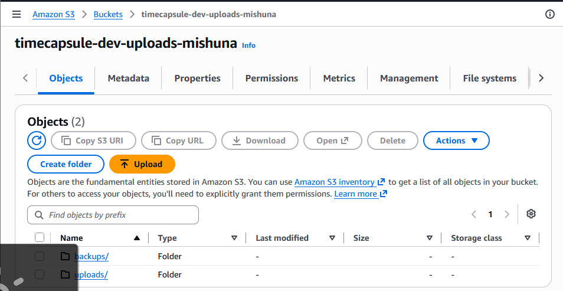

Для изображения были проверены `Key`, `Content-Type`, `ETag` и `Object URL`.

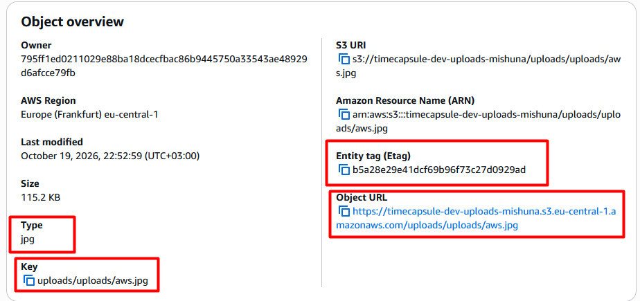

Ключ объекта имеет вид `uploads/<имя-файла>`. `Object URL` не открывается, потому что объект приватный и обычный браузер не передаёт AWS-аутентификацию. Кнопка `Create folder` фактически создаёт префикс ключа, а не настоящую папку.

---

## Задание 2. Объекты из командной строки

В CloudShell была задана переменная бакета и загружены объекты через AWS CLI:

```bash
aws s3 cp photo.txt s3://$BUCKET/uploads/photo.txt
aws s3 sync 2026 s3://$BUCKET/uploads/2026
```

Содержимое бакета было проверено командами:

```bash
aws s3 ls s3://$BUCKET
aws s3 ls s3://$BUCKET/uploads/
aws s3 ls s3://$BUCKET --recursive
```

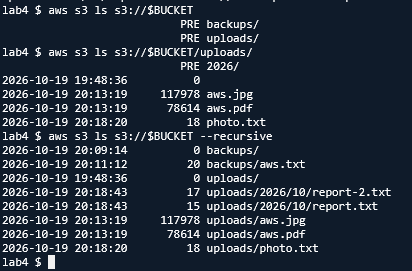

Метаданные объектов были просмотрены без скачивания:

```bash
aws s3api head-object --bucket $BUCKET --key <ключ>
```

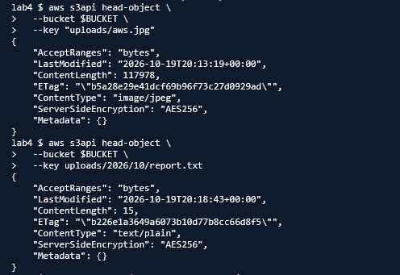

Без `--recursive` AWS CLI показывает префиксы как `PRE uploads/` и `PRE backups/`, а с `--recursive` выводит полные ключи объектов. Для `report.txt` автоматически был определён `Content-Type: text/plain`.

Также один объект был скачан, а `uploads/2026/10/report-2.txt` удалён.

---

## Задание 3. Политика бакета: только HTTPS

В Bucket Policy добавлен явный запрет на любые запросы к бакету по незащищённому HTTP:

```json
"Effect": "Deny",
"Principal": "*",
"Action": "s3:*",
"Condition": {
  "Bool": {
    "aws:SecureTransport": "false"
  }
}
```

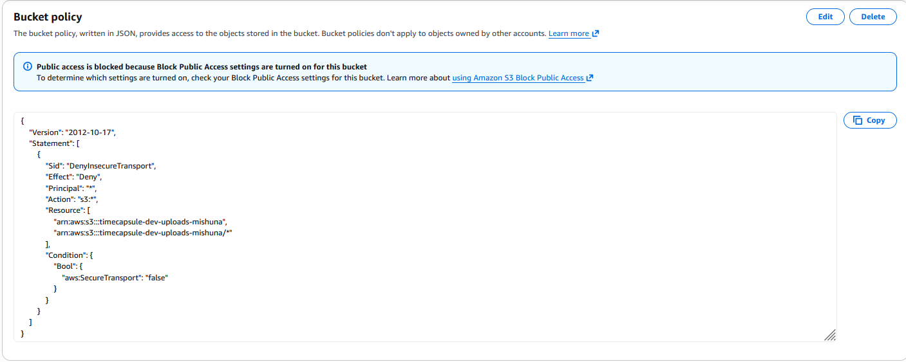

Проверка в CloudShell:

```bash
aws s3 ls s3://$BUCKET/uploads/
aws s3 ls s3://$BUCKET/uploads/ --endpoint-url http://s3.eu-central-1.amazonaws.com
```

HTTPS-запрос выполняется успешно, а HTTP-запрос получает `AccessDenied`.

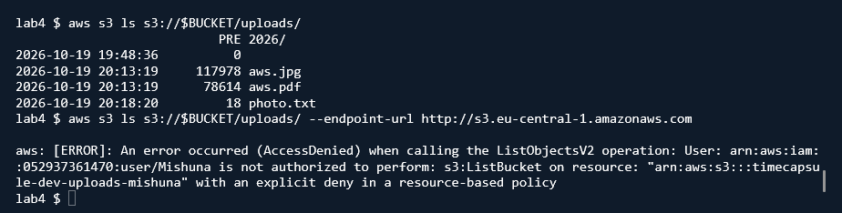

Явный `Deny` имеет приоритет над административными IAM-правами. `Block Public Access` не мешает сохранить эту политику, потому что `"Principal": "*"` используется только в запрещающем правиле и не предоставляет публичный доступ.

---

## Задание 4. Версионирование и защита от удаления

В бакете было включено версионирование. Объекты, загруженные до этого, получили Version ID `null`.

Для `uploads/notes.txt` были созданы две версии:

```text
v1
v2
```

После обычного удаления объекта появился `Delete marker`, а сами версии сохранились.

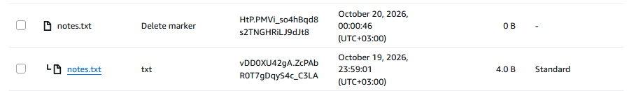

Удаление `Delete marker` восстановило объект с текущей версией `v2`. Затем версия `v2` была удалена, после чего текущей стала версия `v1`.

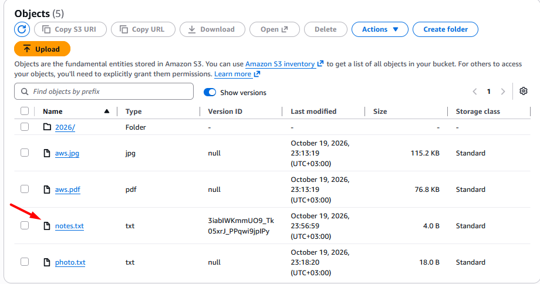
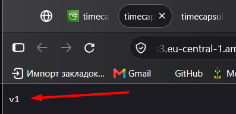

Обычное удаление при включённом versioning можно отменить удалением `Delete marker`. Удаление конкретной версии необратимо, поэтому приложению следует запрещать удалять версии напрямую.

---

## Задание 5. Правило жизненного цикла

Создано правило:

```text
timecapsule-dev-noncurrent
```

Оно действует только для префикса `uploads/`:

- noncurrent-версии → `Standard-IA` через 30 дней;
- noncurrent-версии удаляются через 90 дней;
- две самые новые noncurrent-версии сохраняются;
- незавершённые multipart uploads удаляются через 7 дней.

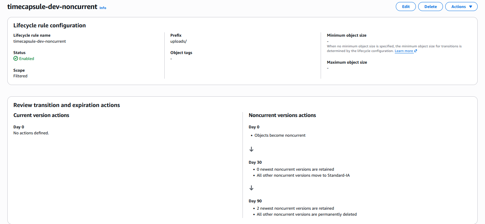

При многократной перезаписи старые версии со временем переходят в Standard-IA и удаляются, а две самые новые неактуальные версии сохраняются. Маленькие тестовые объекты не переходят в Standard-IA из-за минимального размера для Lifecycle transition. Незавершённые multipart uploads занимают хранилище и оплачиваются, поэтому их автоматически очищаем через 7 дней.

---

## Задание 6. Подписанные URL

Для приватных объектов были созданы временные presigned URL из консоли S3 и через AWS CLI:

```bash
aws s3 presign s3://$BUCKET/uploads/photo.txt --expires-in 120
```

После замены ключа `photo.txt` на `notes.txt` S3 отклонил запрос из-за некорректной подписи.

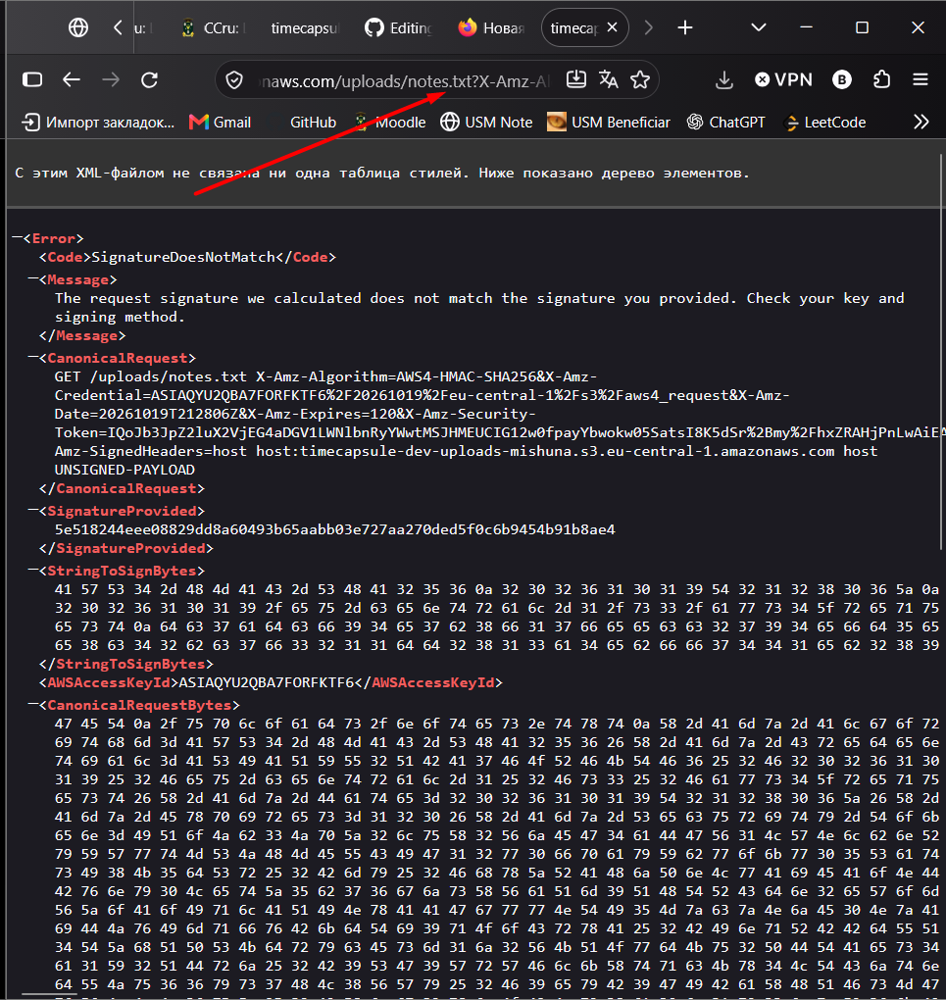

После истечения двух минут исходная ссылка также перестала работать и была отклонена S3 как просроченная.
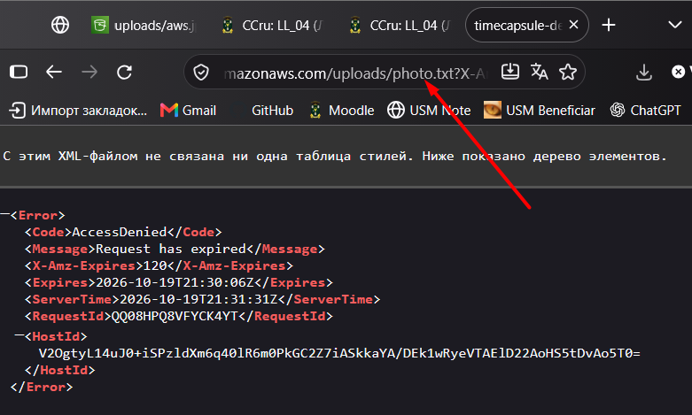

Presigned URL подписывает конкретный запрос и конкретный ключ объекта, поэтому заменить имя файла без пересчёта подписи нельзя. Команда `aws s3 presign` формирует подпись локально из AWS credentials и не требует обращения к S3 для создания ссылки.

---

## Задание 7. Политика приложения

Создана IAM-политика:

```text
timecapsule-dev-app-s3
```

Она разрешает:

- `s3:ListBucket` только для префикса `uploads/`;
- `s3:GetObject`, `s3:PutObject`, `s3:DeleteObject` только для `uploads/*`.

```json
{
  "Action": "s3:ListBucket",
  "Resource": "arn:aws:s3:::timecapsule-dev-uploads-Mishuna"
}
```

```json
{
  "Action": [
    "s3:GetObject",
    "s3:PutObject",
    "s3:DeleteObject"
  ],
  "Resource": "arn:aws:s3:::timecapsule-dev-uploads-Mishuna/uploads/*"
}
```

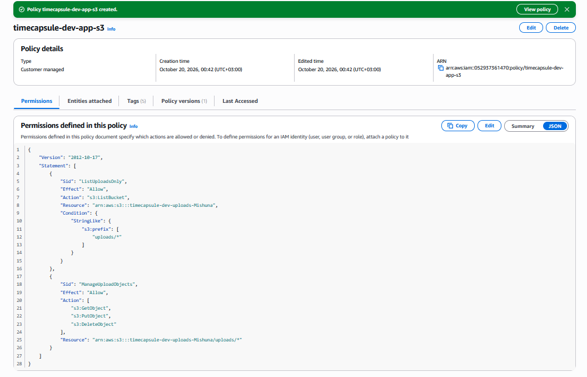

`ListBucket` относится к ARN бакета, потому что работает со списком объектов. Операции `GetObject/PutObject/DeleteObject` относятся к ARN конкретных объектов. Если ARN перепутать, разрешение не совпадёт с ресурсом запроса и будет применён неявный `Deny`.

---

## Задание 8. Проверка прав через тестовую роль

Создана роль `timecapsule-dev-s3-tester`, которой назначена только политика `timecapsule-dev-app-s3`.

В CloudShell роль была принята через `sts:AssumeRole`. Команда:

```bash
aws sts get-caller-identity
```

показала ARN вида:

```text
assumed-role/timecapsule-dev-s3-tester/lab4
```

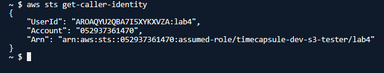

Проверка прав:

| № | Ожидаю | Получил | Правило |
|---|---|---|---|
| 1 | разрешено | разрешено | разрешение политики приложения |
| 2 | разрешено | разрешено | разрешение политики приложения |
| 3 | AccessDenied | AccessDenied | неявный запрет |
| 4 | разрешено | разрешено | разрешение политики приложения |
| 5 | AccessDenied | AccessDenied | неявный запрет |
| 6 | AccessDenied | AccessDenied | неявный запрет |
| 7 | AccessDenied | AccessDenied | неявный запрет |
| 8 | AccessDenied | AccessDenied | неявный запрет |
| 9 | разрешено | разрешено | разрешение политики приложения |
| 10 | AccessDenied | AccessDenied | явный запрет Bucket Policy |


Trust policy определяет, кто может принять роль, а permissions policy — что эта роль может делать. Обычный `DeleteObject` создаёт Delete Marker, поэтому файл можно восстановить. Удаление конкретных версий приложению запрещено, так как `s3:DeleteObjectVersion` отсутствует; при `"s3:*"` такая защита была бы потеряна.

---

## Задание 9. Роль сервера

Создана IAM Role `timecapsule-dev-app-role` с доверием к EC2 и политикой `timecapsule-dev-app-s3`. Роль привязана к экземпляру `timecapsule-dev-app`.

Проверка AWS CLI на сервере:

```bash
aws sts get-caller-identity
aws s3 ls s3://$BUCKET/uploads/
aws s3 ls s3://$BUCKET/backups/
```

Роль определилась успешно. Доступ к `uploads/` разрешён, к `backups/` получен `AccessDenied`.

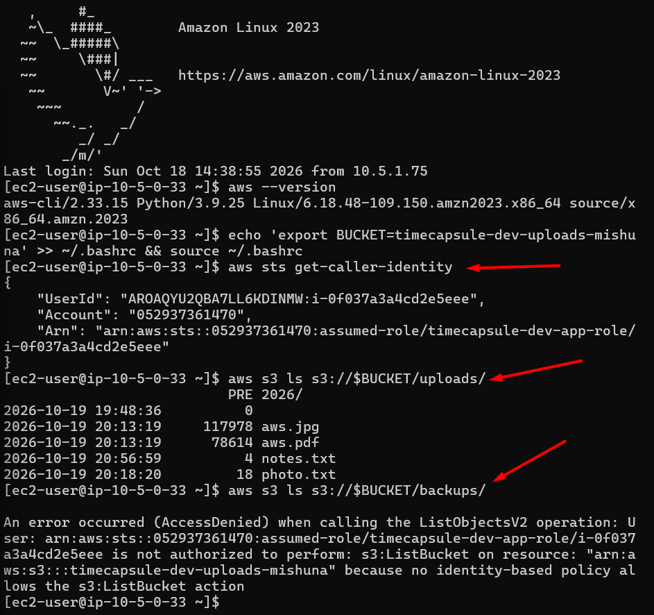

AWS CLI получает временные credentials через IAM Instance Profile и IMDS. В отличие от тестовой роли с доверием к AWS-аккаунту, серверная роль доверяет сервису EC2. Временные автоматически обновляемые credentials безопаснее постоянного ключа в `.env`.

---

## Задание 10. Перенос существующих файлов

Существующие вложения TimeCapsule перенесены из `storage/uploads` в S3:

```bash
aws s3 sync storage/uploads s3://$BUCKET/uploads/
```

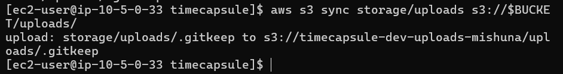

Повторная проверка:

```bash
aws s3 sync storage/uploads s3://$BUCKET/uploads/ --dryrun
```

Не обнаружила файлов для повторной загрузки.

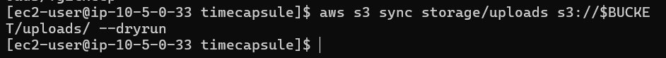

Для перенесённого объекта проверен `Content-Type`.

Прав политики приложения достаточно: `s3:ListBucket` используется для сравнения содержимого, а `s3:PutObject` — для загрузки файлов.

---

## Задание 11. Модуль хранения на S3

Модуль хранения TimeCapsule переведён с локального диска на Amazon S3. Подключён AWS SDK для PHP, добавлены настройки `S3_BUCKET` и `AWS_REGION` в `.env.example`.

Реализованы функции `storage_save()`, `storage_delete()` и `storage_stream()`: загрузка файлов в S3 с указанием `Content-Type`, удаление объектов и выдача временных подписанных ссылок сроком на 5 минут. Приложение использует IAM Role для доступа к S3 без хранения ключей доступа в `.env`.

В подвале страницы указано имя S3-бакета вместо локального хранилища.

**Изменения модуля хранения в репозитории:** [ссылка на коммит](https://github.com/eredin-cloud/timecapsule/commit/691f7b7)

## Задание 12. Деплой и проверка

Новая версия TimeCapsule развёрнута на EC2. Выполнен `composer install`, настроены `S3_BUCKET` и `AWS_REGION` в `.env`, приложение перезапущено через PHP-FPM.

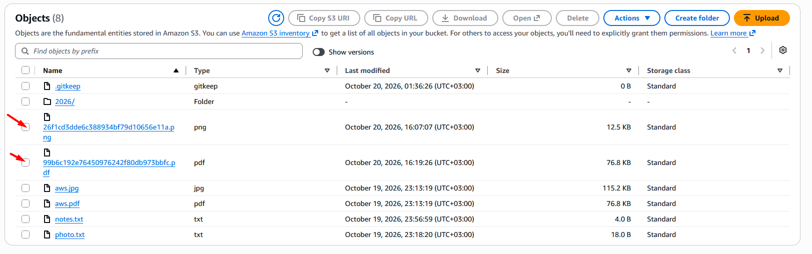

Созданы новые капсулы с изображением и PDF. Проверено наличие объектов в S3 и их `Content-Type`.

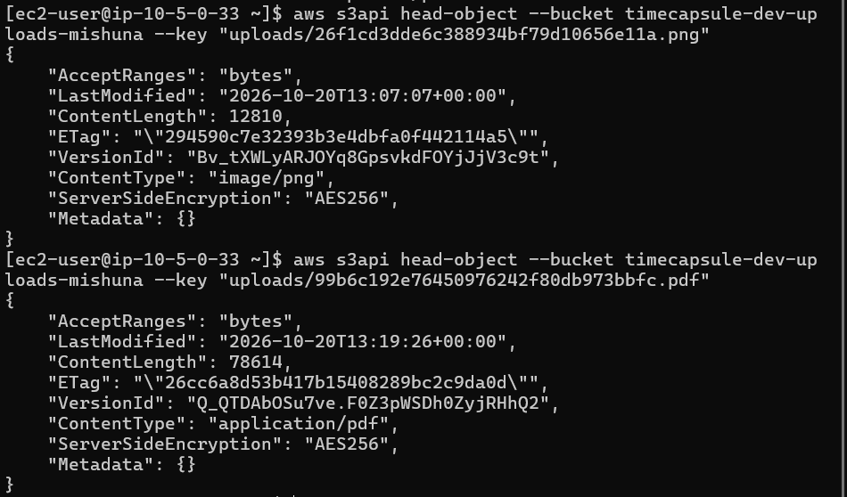

```bash
aws s3 ls s3://timecapsule-dev-uploads-mishuna/uploads/ --recursive
aws s3api head-object --bucket timecapsule-dev-uploads-mishuna --key "uploads/ИМЯ_ФАЙЛА"
```

Проверено открытие вложения из старой капсулы, созданной в ЛР2. Изображение открывается по предварительно подписанной ссылке S3 с параметрами `X-Amz-*`.

После истечения 5 минут проверена недействительность ссылки. После удаления капсулы проверен объект в S3 с включённым `Show versions`: при включённом версионировании предыдущая версия может сохраняться вместе с маркером удаления.
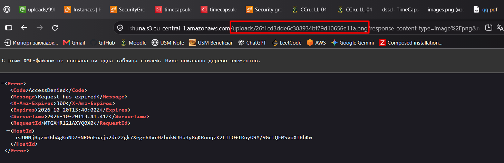

---

## Задание 13. Сервер без состояния

Папка `storage/uploads` перемещена в резервное место. Старые и новые капсулы открываются, создание новой капсулы с вложением работает без локальных файлов.

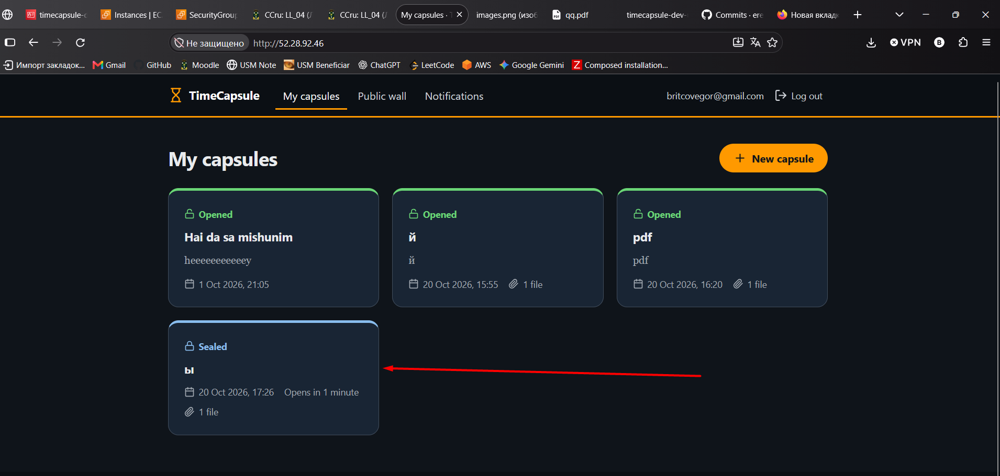

Из IAM-политики `timecapsule-dev-app-s3` удалено разрешение `s3:ListBucket`. Приложение продолжает работать с объектами S3, а команда просмотра содержимого бакета возвращает `AccessDenied`.

```bash
aws s3 ls s3://timecapsule-dev-uploads-mishuna/uploads/
```

При запросе несуществующего объекта получены разные ответы:

- На EC2 под IAM-ролью приложения — `403 Forbidden`.
- В CloudShell — `404 Not Found`.

```bash
aws s3 cp s3://timecapsule-dev-uploads-mishuna/uploads/no-such-file.txt -
```

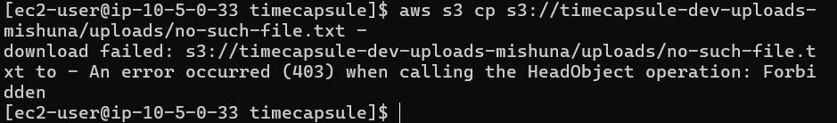
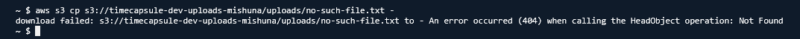

S3 возвращает разные ответы, поскольку роль приложения не имеет разрешения `s3:ListBucket` и не может проверить отсутствие объекта. Это предотвращает раскрытие информации о существовании объектов. Хранение вложений в S3 позволяет заменить EC2-сервер без потери данных.

---

## Задание 14. Архитектура и решение

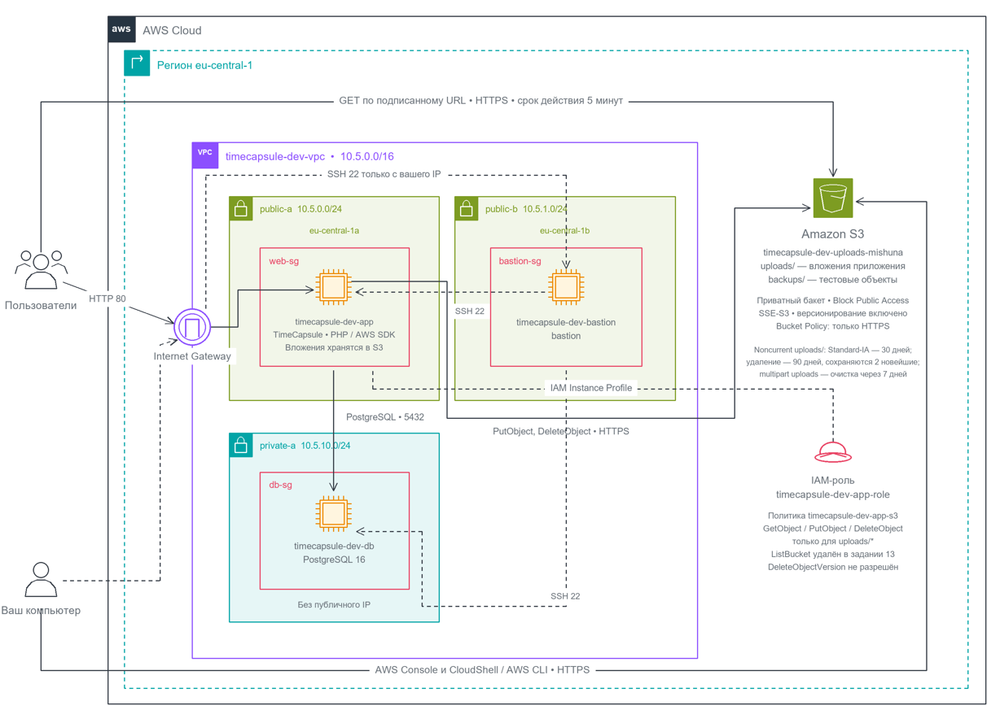

[ADR-0003](../adr/0003-attachment-storage.md)
---

## Контрольные вопросы
1. Как проходит запрос на скачивание вложения?
Пользователь нажимает ссылку в браузере, после чего приложение проверяет, имеет ли пользователь право просматривать соответствующую капсулу и вложение. Затем приложение с помощью IAM-роли EC2 получает разрешение обратиться к S3 и создаёт подписанный URL. Браузер скачивает файл напрямую из S3, а AWS проверяет подпись ссылки, срок её действия и разрешения, на основании которых она была создана.
2. Какие настройки бакета и свойства URL защищают вложение?
Бакет должен быть приватным, с включённым Block Public Access, без публичных политик доступа. Подписанный URL содержит подпись, срок действия и параметры запроса, поэтому открыть файл можно только по действительной ссылке до истечения её срока. Ссылка может быть передана другому человеку, поэтому её срок действия следует ограничивать.
3. Почему используется подписанный URL, а не публичный доступ к бакету?
Подписанный URL позволяет предоставить временный доступ к конкретному объекту, не открывая весь бакет для всех пользователей. Файл скачивается напрямую из S3, что снижает нагрузку на сервер приложения. Публичный доступ увеличил бы риск утечки вложений и позволил бы посторонним получать файлы без авторизации в приложении.
4. Как изменить схему, чтобы пережить отказ региона eu-central-1?
Нужно настроить репликацию вложений в отдельный бакет другого региона, например eu-west-1, и обеспечить независимый доступ к резервным объектам. При отказе основного региона приложение переключается на резервный регион, где создаёт новые подписанные URL. Для полноценного восстановления также понадобятся резервное развёртывание приложения, необходимые IAM-разрешения и механизм переключения, а не только копии файлов.
