# Лабораторная работа №5
## Дисциплина: Cloud Computing
## Облачные базы данных. Amazon RDS
## Выполнил: Бритков Егор, Informatica, I2402
## Выбранный уровень: Продвинутый, вариант деплоя B
## Репозиторий: https://github.com/eredin-cloud/timecapsule

**Цель работы:** научиться размещать базу данных в Amazon RDS с ограниченным сетевым доступом, работать с репликой для чтения и восстанавливать данные после ошибки. Перенести базу приложения с EC2 в RDS и организовать её работу без лишних расходов.

---

## Задание 1. Размещение и доступ к базе

Подготовка выполнена в регионе `eu-central-1`, в существующей VPC `timecapsule-dev-vpc` с диапазоном `10.5.0.0/16`. Для подключения к учебной базе используется `timecapsule-dev-app`, поскольку временный `web-server` был удалён в ЛР3.

Создана группа подсетей `lab5-db-subnets`, включающая приватные подсети из ЛР3:

| Подсеть | Зона доступности | CIDR |
|---|---|---|
| `timecapsule-dev-private-a` | `eu-central-1a` | `10.5.10.0/24` |
| `timecapsule-dev-private-b` | `eu-central-1b` | `10.5.11.0/24` |

Созданы две отдельные Security Group:

| Группа | Назначение | Входящие правила |
|---|---|---|
| `lab5-web-sg` | Обозначает сервер приложения, которому разрешён доступ к учебной RDS | Отсутствуют |
| `lab5-db-sg` | Ограничивает подключения к учебной базе | PostgreSQL, TCP/5432, источник — `lab5-web-sg` |

Группа `lab5-web-sg` добавлена к `timecapsule-dev-app` дополнительно к существующей `timecapsule-dev-web-sg`. Существующая группа продолжает обеспечивать доступ к приложению, SSH через bastion и подключение к базе на `db-server`. Исходящие правила новых групп оставлены стандартными. Созданным учебным ресурсам назначен тег `Lab = lab5`.

Подготовлены приватные подсети и правило доступа для будущего экземпляра RDS. Сам экземпляр базы данных на этом этапе ещё не создавался, проверка подключения будет выполнена в следующих заданиях.

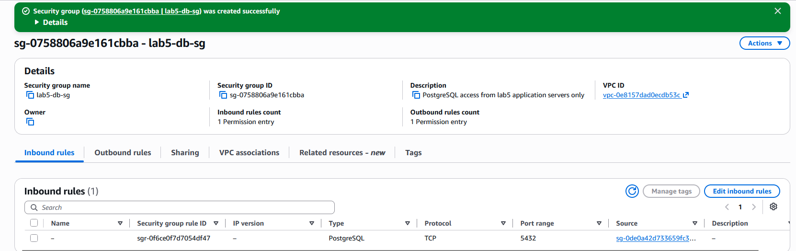
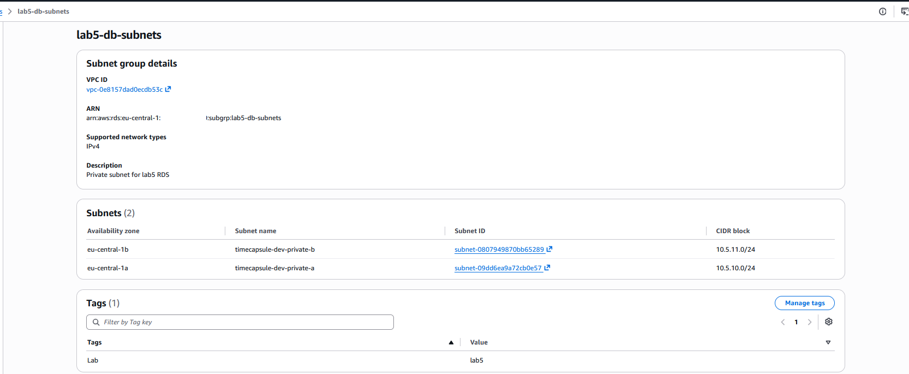

### Почему удобнее использовать Security Group источника, а не IP-адрес?

Правило разрешает подключения экземплярам, которым назначена нужная Security Group, и не требует изменения при смене их IP-адресов. Новый сервер приложения можно включить в разрешённую группу без редактирования правила базы. Поэтому `lab5-web-sg` следует назначать только серверам, которым нужен доступ к учебной базе.

### Зачем указывать две подсети, если учебная база работает в одной зоне?

Для обычного регионального развёртывания RDS группа подсетей должна охватывать минимум две зоны доступности, даже при использовании Single-AZ. Такая конфигурация также позволяет в дальнейшем перейти на Multi-AZ. Наличие двух подсетей само по себе не создаёт второй экземпляр базы или реплику.

---

## Задание 2. База RDS

Создан учебный экземпляр Amazon RDS `lab5-db` с движком PostgreSQL 18.3. Использован шаблон `Sandbox`, развёртывание — Single-AZ. После создания экземпляр перешёл в состояние `Available`.

| Параметр | Значение |
|---|---|
| Регион и зона доступности | `eu-central-1`, `eu-central-1a` |
| Класс экземпляра | `db.t4g.micro` |
| Хранилище | `gp3`, 20 ГиБ, автоматическое увеличение выключено |
| Имя базы внутри экземпляра | `lab5` |
| Главный пользователь | `dbadmin` |
| VPC | `timecapsule-dev-vpc` |
| Группа подсетей | `lab5-db-subnets` |
| Публичный доступ | Выключен |
| Security Group | `lab5-db-sg` |
| Порт PostgreSQL | TCP/5432 |
| Автоматические резервные копии | Включены, срок хранения — 7 дней |
| Шифрование хранилища | Включено |
| Deletion protection | Включена |
| Тег | `Lab = lab5` |

Вместо имени `lab5-rds-sg`, указанного в задании 2, используется созданная в задании 1 группа `lab5-db-sg` с тем же назначением: входящие подключения TCP/5432 разрешены только от `lab5-web-sg`. Пароль задан самостоятельно и в отчёт не включён.

Резервные копии и журналы транзакций позволяют восстанавливать экземпляр на момент времени в пределах доступного окна восстановления. После создания базы это окно накапливается постепенно; настройка 7 дней не означает наличия истории за время до создания экземпляра.

### Как убедиться, что база принимает подключения только с нужного сервера?

Нужно проверить, что публичный доступ выключен, к экземпляру назначена только `lab5-db-sg`, а её единственное входящее правило разрешает TCP/5432 от `lab5-web-sg`. Группа источника должна быть назначена только нужному серверу приложения. Затем необходимо подтвердить успешное подключение с `app-server` и отсутствие доступа с `bastion`; практические проверки выполняются в следующем задании.

### Почему выбрана зона eu-central-1a?

Сервер приложения находится в подсети `public-a` в зоне `eu-central-1a`, поэтому база размещена в той же зоне. Это уменьшает задержку и позволяет избежать межзонального трафика между приложением и базой. Развёртывание Single-AZ не обеспечивает автоматического переключения на резервный экземпляр при отказе зоны.

### От чего защищает deletion protection, а от чего нет?

Deletion protection блокирует удаление экземпляра RDS через консоль, CLI и API, пока защита явно не отключена. Она не предотвращает выполнение SQL-команд `DELETE`, `TRUNCATE` или `DROP TABLE`, а также ошибочное изменение данных. Для восстановления после таких ошибок нужны резервные копии и журналы транзакций.

---

## Задание 3. Подключение к базе

Для подключения использован существующий сервер приложения `timecapsule-dev-app` с приватным IP `10.5.0.33` и группой `lab5-web-sg`. Административное SSH-подключение выполнено через bastion.

С сервера приложения установлено соединение с RDS:

```bash
PGSSLMODE=require PGCONNECT_TIMEOUT=10 psql -h "$RDS_ENDPOINT" -U dbadmin -d lab5 -W
```

Переменная `RDS_ENDPOINT` содержит DNS-имя учебного экземпляра `lab5-db`. Команда `\conninfo` подтвердила подключение к базе `lab5` от имени `dbadmin`, порт `5432`, адрес базы `10.5.10.236`. Соединение зашифровано: TLS 1.3, шифр `TLS_AES_256_GCM_SHA384`.

### Учебная таблица

Создана и заполнена учебная таблица `notes`:

```sql
CREATE TABLE notes (
    id         SERIAL PRIMARY KEY,
    body       VARCHAR(100) NOT NULL,
    created_at TIMESTAMPTZ NOT NULL DEFAULT now()
);

INSERT INTO notes (body) VALUES ('first'), ('second'), ('third');
SELECT * FROM notes;
```

Запрос `SELECT * FROM notes;` подтвердил наличие трёх строк:

```text
 id |  body  |          created_at
----+--------+-------------------------------
  1 | first  | 2026-10-30 18:19:54.360936+00
  2 | second | 2026-10-30 18:19:54.360936+00
  3 | third  | 2026-10-30 18:19:54.360936+00
(3 rows)
```

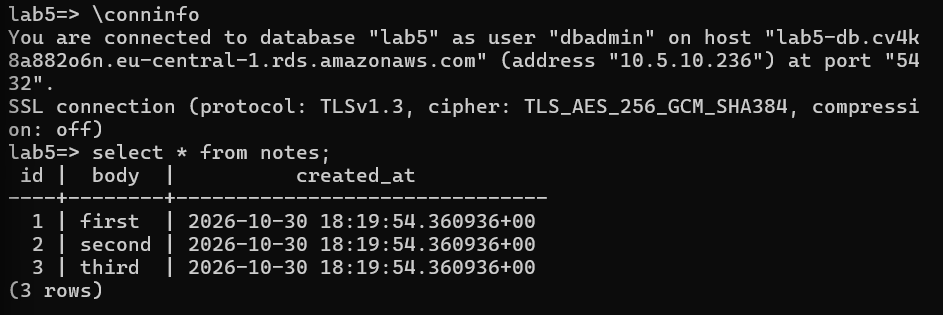

### Разрешение DNS-имени

На сервере приложения выполнены `dig +short "$RDS_ENDPOINT"` и `nslookup` для endpoint RDS. На локальном Windows-компьютере выполнен `nslookup` для того же имени.

| Место проверки | Результат |
|---|---|
| `app-server` | `10.5.10.236` |
| Локальный Windows-компьютер | `10.5.10.236` |

В обоих случаях имя разрешилось в приватный IP базы из подсети `private-a`. Доступность DNS-записи с локального компьютера сама по себе не означает возможности подключиться к базе через интернет.

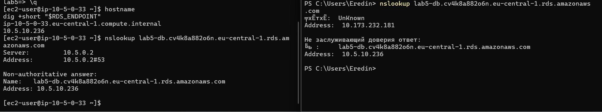

### Проверка сетевого доступа

Доступ к TCP-порту `5432` проверен с двух серверов:

| Сервер | Приватный IP | Фактический результат |
|---|---|---|
| `app-server` | `10.5.0.33` | `5432 OPEN` |
| `bastion` | `10.5.1.75` | `5432 UNREACHABLE` |

Результаты соответствуют настроенному ограничению: соединение разрешено с сервера приложения, которому назначена `lab5-web-sg`, а с bastion порт недоступен.

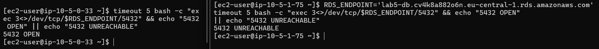

---

## Задание 4. Реплика для чтения

Для основной базы `lab5-db` создана реплика `lab5-db-replica`: класс `db.t4g.micro`, зона `eu-central-1b`, публичный доступ выключен, доступ ограничен группой `lab5-db-sg`. Защита от удаления для временной реплики выключена. После перехода реплики в состояние `Available` подключение выполнено с `app-server` по отдельному endpoint.

Запрос `SELECT pg_is_in_recovery();` вернул разные результаты:

| Экземпляр | Результат | Назначение |
|---|---|---|
| `lab5-db` | `f` | Основная база, доступна запись |
| `lab5-db-replica` | `t` | Реплика, применяет изменения основной базы |

На реплике прочитаны три существующие строки таблицы `notes`. Попытка записи:

```sql
INSERT INTO notes (body) VALUES ('from replica');
```

завершилась ожидаемой ошибкой:

```text
ERROR: cannot execute INSERT in a read-only transaction
```

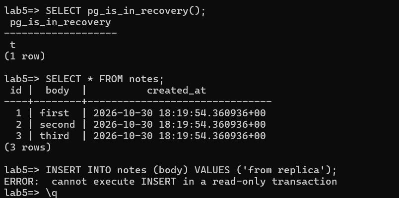

На основной базе выполнена команда:

```sql
INSERT INTO notes (body) VALUES ('fourth');
```

После повторного подключения к реплике запрос `SELECT * FROM notes;` вернул четыре строки: `first`, `second`, `third`, `fourth`. У строки `fourth` на обеих базах совпадают `id = 4` и `created_at = 2026-10-30 19:40:40.949039+00`, что подтверждает передачу изменения.

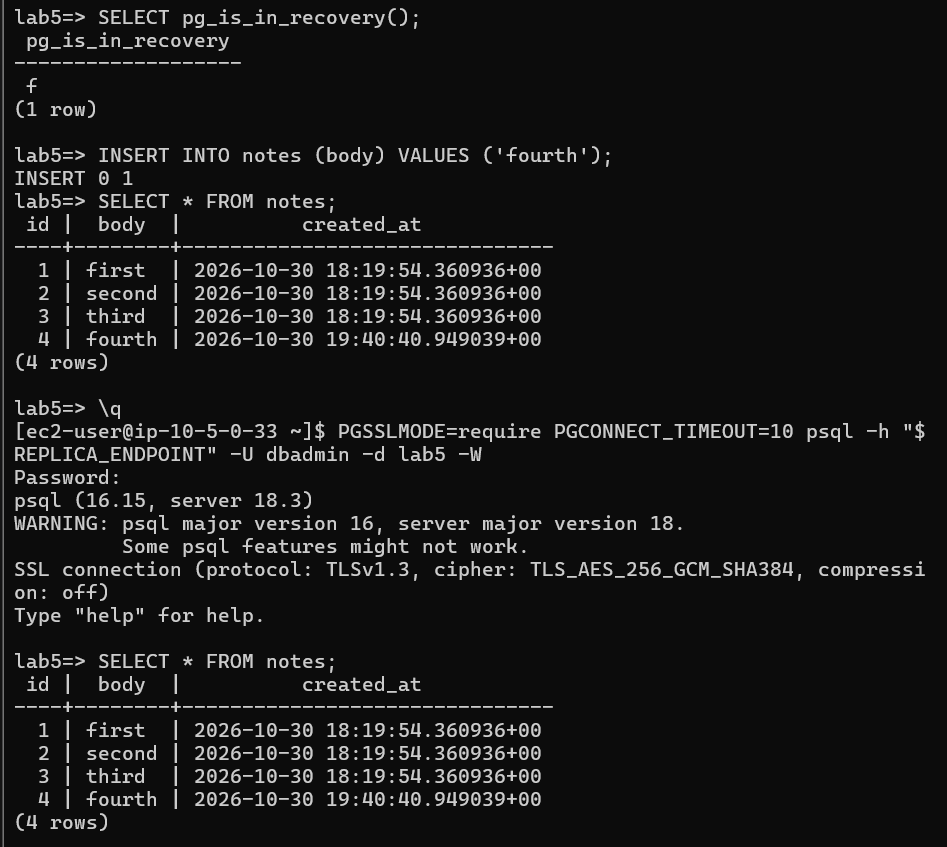

Во вкладке `Monitoring` реплики просмотрена метрика `ReplicaLag`. На сохранённом графике выбран диапазон последнего часа, статистика `Average`, период агрегации — 1 минута, часовой пояс — UTC. На видимом участке значения колеблются примерно от **11 до 22 секунд**. Для точки `2026-10-30 19:24:00 UTC` показано значение **22 секунды**. Это минутные средние значения метрики, а не измеренное время передачи отдельной строки `fourth`.

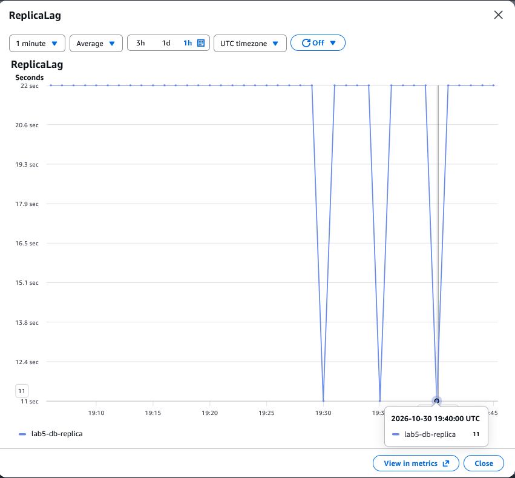

### Почему INSERT на реплике не выполнился?

Реплика находится в режиме восстановления и применяет изменения, поступающие от основной базы. Пользовательские соединения работают только на чтение, поэтому команда `INSERT` отклоняется. Запись выполняется на основной базе и затем асинхронно передаётся на реплику.

### Чем реплика для чтения отличается от резервного экземпляра Multi-AZ?

Реплика для чтения имеет отдельный endpoint, обслуживает запросы чтения и обновляется асинхронно, поэтому может отставать от основной базы. Резервный экземпляр классического Multi-AZ DB instance обновляется синхронно и предназначен для автоматического переключения при отказе основной базы. Такой standby не обслуживает пользовательские запросы чтения напрямую.

---

## Задание 5. Восстановление после ошибки

Для имитации случайного удаления данных на основной учебной базе выполнена команда:

```sql
DELETE FROM notes;
```

После передачи изменения на реплику запрос `SELECT * FROM notes;` также вернул `(0 rows)`. Таким образом, реплика повторила удаление данных основной базы.

Восстановление выполнено из резервных копий исходного экземпляра `lab5-db` в отдельный экземпляр `lab5-db-restore` с помощью `Restore to point in time`. Исходная отметка T0 не сохранилась, поэтому для повторного восстановления выбрана точка после ранее подтверждённого добавления строки `fourth`.

| Параметр | Значение |
|---|---|
| Источник восстановления | `lab5-db` |
| Восстановленная копия | `lab5-db-restore` |
| Выбранная точка UTC | `2026-10-30 19:41:00 UTC` |
| Та же точка в часовом поясе формы | `2026-10-30 21:41:00 UTC+02:00` |
| Earliest restorable time при проверке | `2026-10-30 19:00 UTC+02:00` |
| Latest restorable time при проверке | `2026-11-02 20:51 UTC+02:00` |
| Развёртывание и класс | Single-AZ, `db.t4g.micro` |
| Группа подсетей | `lab5-db-subnets` |
| Публичный доступ | Выключен |
| Security Group | `lab5-db-sg` |
| Защита от удаления копии | Выключена |

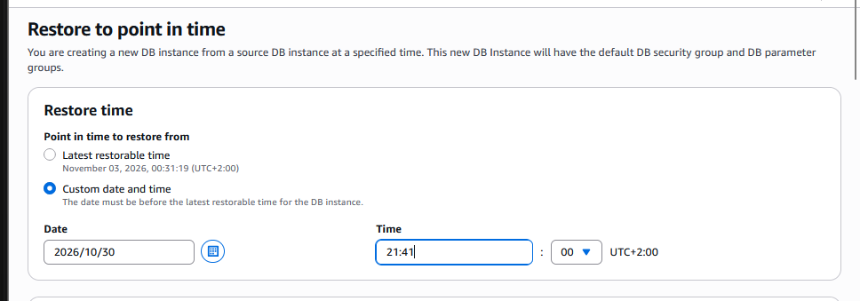

Выбранный момент находился внутри доступного окна восстановления. После перехода новой копии в состояние `Available` выполнено подключение с `app-server` и проверка:

```sql
SELECT * FROM public.notes;
```

Подключение к `lab5-db-restore` подтверждено командой `\conninfo`: адрес восстановленной копии — `10.5.10.118`, соединение защищено TLS 1.3. Запрос вернул четыре строки: `first`, `second`, `third`, `fourth`, с исходными идентификаторами и временем создания. Восстановление выполнено в отдельную копию и не изменяет данные исходного экземпляра.


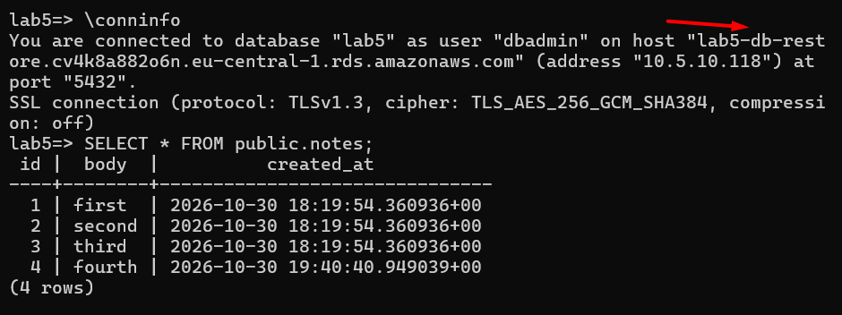

После проверок временные экземпляры `lab5-db-replica` и `lab5-db-restore` удалены.


### Почему реплика не спасла данные?

Реплика повторяет изменения основной базы, включая удаление строк. Поэтому ошибочная команда `DELETE` также передаётся на реплику, и она не обеспечивает сохранение предыдущего состояния таблицы. Для возврата к состоянию до удаления используются резервные копии и журналы транзакций.

### Почему восстановление создаёт новую базу, а не откатывает старую?

Отдельный экземпляр позволяет проверить восстановленные данные, сохранив текущее состояние исходной базы. Можно сравнить результаты, перенести нужные данные или переключить приложение на восстановленный экземпляр. Исходная база при этом не перезаписывается автоматически.

---

## Завершение Части 1

У учебной базы `lab5-db` отключена защита от удаления, после чего экземпляр удалён без финального снимка и без сохранения автоматических резервных копий. Проверено отсутствие экземпляров `lab5-db`, `lab5-db-replica` и `lab5-db-restore`.

После удаления базы удалены учебная группа подсетей `lab5-db-subnets` и группа доступа `lab5-db-sg`. Дополнительная группа `lab5-web-sg` снята с сервера приложения и удалена; существующая `timecapsule-dev-web-sg` сохранена. Приватные подсети и остальные ресурсы ЛР3 сохранены для Части 2.

---

## Часть 2. Продвинутый уровень

## Задание 6. База приложения

Для переноса базы TimeCapsule с EC2 в Amazon RDS создана группа подсетей `timecapsule-dev-db-subnets`. В неё включены существующие приватные подсети `timecapsule-dev-private-a` (`eu-central-1a`, `10.5.10.0/24`) и `timecapsule-dev-private-b` (`eu-central-1b`, `10.5.11.0/24`).

Создана группа доступа `timecapsule-dev-rds-sg`. Её входящее правило разрешает PostgreSQL по TCP/5432 только от группы сервера приложения `timecapsule-dev-web-sg`.

Создан экземпляр RDS `timecapsule-dev-rds`, который перешёл в состояние `Available`:

| Параметр | Значение |
|---|---|
| Движок | PostgreSQL 18.3 |
| Шаблон | `Sandbox` |
| Развёртывание | Single-AZ |
| Класс | `db.t4g.micro` |
| Хранилище | `gp3`, 20 ГиБ, автоматическое увеличение выключено |
| Главный пользователь | `dbadmin` |
| Initial database name | Не задано |
| VPC | `timecapsule-dev-vpc` |
| Группа подсетей | `timecapsule-dev-db-subnets` |
| Зона доступности | `eu-central-1a` |
| Публичный доступ | Выключен |
| Security Group | `timecapsule-dev-rds-sg` |
| Порт | TCP/5432 |
| Автоматические резервные копии | 7 дней |
| Шифрование | Включено |
| Deletion protection | Включена |
| Теги проекта | `Project = timecapsule`, `Environment = dev`, `Lab = lab5` |

Во вкладке `Connectivity & security` подтверждены приватное размещение, группа доступа и endpoint:

```text
timecapsule-dev-rds.cv4k8a882o6n.eu-central-1.rds.amazonaws.com
```

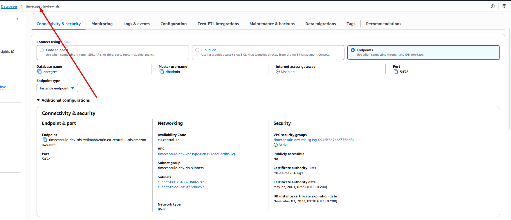

База `timecapsule` на этом этапе не создавалась; её создание предусмотрено заданием 8. В консоли отображается стандартная база `postgres`. Данные приложения пока остаются на прежнем EC2 `db-server`; переключение приложения на RDS ещё не выполнялось.

### Какие параметры базы приложения следует изменить для рабочей системы с реальными пользователями?

Для рабочей системы следует использовать Multi-AZ для автоматического переключения при отказе основной базы. Класс экземпляра и объём хранилища нужно выбирать по измеренной нагрузке, предусмотрев контролируемое автоматическое увеличение хранилища. Следует настроить оповещения о нагрузке, свободном месте и ошибках, а срок хранения резервных копий определить по требованиям к восстановлению. Восстановление из резервных копий необходимо регулярно проверять на практике.

---

## Задание 7. Ночная остановка базы

Создана IAM-политика `timecapsule-dev-rds-stop`, разрешающая только действие `rds:StopDBInstance` для экземпляра `timecapsule-dev-rds`. Номер аккаунта в примере ARN скрыт:

```json
{
  "Version": "2012-10-17",
  "Statement": [
    {
      "Effect": "Allow",
      "Action": "rds:StopDBInstance",
      "Resource": "arn:aws:rds:eu-central-1:<ACCOUNT_ID>:db:timecapsule-dev-rds"
    }
  ]
}
```

Политика назначена роли `timecapsule-dev-scheduler-role`. Её доверительная политика разрешает `sts:AssumeRole` только сервису `scheduler.amazonaws.com`.

В EventBridge Scheduler создано расписание со следующими итоговыми настройками:

| Параметр | Значение |
|---|---|
| Имя | `timecapsule-dev-rds-nightly-stop` |
| Группа | `default` |
| Тип | Recurring, Cron-based |
| Итоговое выражение | `0 23 * * ? *` |
| Часовой пояс | `Europe/Chisinau` |
| Flexible time window | `Off` |
| Target | All APIs → Amazon RDS → `StopDBInstance` |
| Роль выполнения | `timecapsule-dev-scheduler-role` |

Входные данные цели:

```json
{
  "DbInstanceIdentifier": "timecapsule-dev-rds"
}
```

Для проверки сначала задано тестовое время примерно через пять минут. База была остановлена расписанием; во вкладке `Logs & events` зафиксировано событие `DB instance stopped` от **3 ноября 2026, 15:56 (UTC+02:00)**. Это время события завершения остановки, а не обязательно точная минута вызова расписания.

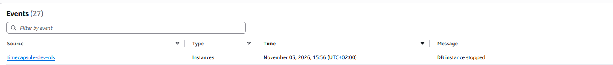

После проверки выражение изменено на ежедневную остановку в **23:00 по времени Кишинёва**. В предварительном просмотре расписания ближайший запуск указан на 3 ноября 2026 в 23:00, последующие — ежедневно в то же местное время.

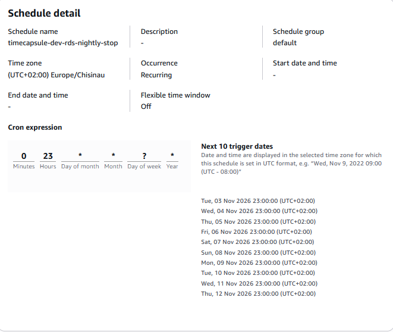

После теста база снова запущена для следующих заданий. Расписание сохранено включённым; в начале следующих занятий базу необходимо запускать вручную.

### Зачем расписанию своя роль, если пользователь сам может остановить базу?

Scheduler выполняет действие самостоятельно, без активного сеанса пользователя. Роль предоставляет сервису временные полномочия для вызова API, а доверительная политика определяет, кто может её принять. Права пользователя автоматически расписанию не передаются.

### Почему роль может остановить только одну базу?

Политика роли разрешает только действие `rds:StopDBInstance`, а в `Resource` указан ARN конкретного экземпляра `timecapsule-dev-rds`. Другие базы не соответствуют этому ресурсу, поэтому данная политика не разрешает их остановку. Право запуска базы или её удаления этой политикой также не предоставляется.

---

## Задание 8. Пользователь и база данных

С `app-server` выполнено подключение к экземпляру `timecapsule-dev-rds` под пользователем `dbadmin`, с указанием служебной базы `postgres`. Для приложения созданы отдельный пользователь и база данных:

```sql
CREATE USER timecapsule;
\password timecapsule
GRANT timecapsule TO dbadmin;
CREATE DATABASE timecapsule OWNER timecapsule;
```

Пароль пользователя `timecapsule` задан через интерактивную команду `\password`: использовано существующее значение `DB_PASSWORD` из `.env`. Пароль не включён в команды SQL, историю `psql` или отчёт; файл `.env` на этом этапе не изменялся. Членство `dbadmin` в роли `timecapsule` позволяет назначить её владельцем создаваемой базы.

Владелец проверен запросом:

```sql
SELECT datname, pg_get_userbyid(datdba) AS owner
FROM pg_database
WHERE datname = 'timecapsule';
```

Получен результат:

```text
   datname   |    owner
-------------+-------------
 timecapsule | timecapsule
(1 row)
```

Затем с `app-server` выполнено отдельное подключение к RDS под пользователем приложения:

```bash
PGSSLMODE=require PGCONNECT_TIMEOUT=10 psql -h "$APP_RDS_ENDPOINT" -U timecapsule -d timecapsule -W
```

Переменная `APP_RDS_ENDPOINT` содержит endpoint `timecapsule-dev-rds`. Соединение установлено с PostgreSQL 18.3 по TLS 1.3 с шифром `TLS_AES_256_GCM_SHA384`. Проверка `SELECT current_user, current_database();` вернула:

```text
 current_user | current_database
--------------+------------------
 timecapsule  | timecapsule
(1 row)
```

Подтверждены владелец базы и успешная аутентификация отдельного пользователя приложения. Перенос таблиц и данных со старого `db-server` на этом этапе ещё не выполнялся.

### Почему приложению нужен отдельный пользователь, а не dbadmin?

Отдельный пользователь позволяет ограничить полномочия приложения необходимыми операциями с его базой данных. Использование `dbadmin` при компрометации приложения предоставило бы злоумышленнику значительно более широкие административные возможности. Отдельная учётная запись также позволяет независимо управлять паролем и правами доступа приложения.

---

## Задание 9. Перенос данных

С `app-server` выполнена выгрузка базы со старого `db-server` по имени `db.timecapsule.internal`:

```bash
PGCONNECT_TIMEOUT=10 pg_dump -h db.timecapsule.internal -U timecapsule -d timecapsule --no-owner --no-privileges -W -f timecapsule.sql
```

Дамп размещён в каталоге `~/lab5-migration` вне репозитория; перед созданием файла установлена маска прав `umask 077`. Параметры `--no-owner` и `--no-privileges` исключают команды восстановления прежних владельцев и прав.

Загрузка в RDS выполнена под пользователем `timecapsule`:

```bash
PGSSLMODE=require PGCONNECT_TIMEOUT=10 psql -X -h "$APP_RDS_ENDPOINT" -U timecapsule -d timecapsule -W --set=ON_ERROR_STOP=on --single-transaction -f timecapsule.sql
```

Импорт выполняется одной транзакцией с остановкой и откатом при ошибке. После загрузки на обеих базах выполнен запрос:

```sql
SELECT current_database() AS db,
       inet_server_addr() AS server_ip,
       (SELECT count(*) FROM public.users) AS users,
       (SELECT count(*) FROM public.capsules) AS capsules;
```

| База | Адрес сервера при проверке | users | capsules |
|---|---|---:|---:|
| PostgreSQL на `db-server` | `10.5.10.170` | 3 | 4 |
| PostgreSQL в RDS | `10.5.10.21` | 3 | 4 |

Количество пользователей и капсул совпало. Сравнение выполнено непосредственно через `psql`, без обращения к веб-приложению.

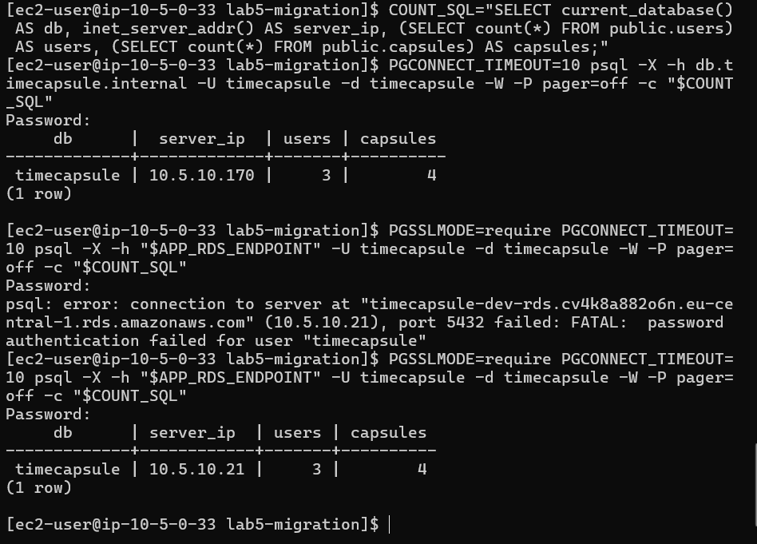

После сравнения для удаления выгрузки, содержащей хеши паролей пользователей, выполнена команда в каталоге `~/lab5-migration`:

```bash
rm -- timecapsule.sql
```

Приложение на этом этапе ещё настроено на старую базу. С момента выгрузки до переключения DNS и проверки нового подключения в задании 10 обращения к приложению приостановлены, чтобы новые изменения старой базы не разошлись с перенесёнными данными.

---

## Задание 10. Переключение приложения

В приватной зоне Route 53 `timecapsule.internal` удалена A-запись `db`, указывавшая на старый `db-server`, и создана запись CNAME:

```text
db.timecapsule.internal → timecapsule-dev-rds.cv4k8a882o6n.eu-central-1.rds.amazonaws.com
TTL: 60 секунд
```

С `app-server` выполнена проверка:

```bash
dig db.timecapsule.internal +noall +answer
```

Имя разрешилось через CNAME в endpoint RDS и далее в приватный адрес `10.5.10.21`:

```text
db.timecapsule.internal. 60 IN CNAME timecapsule-dev-rds.cv4k8a882o6n.eu-central-1.rds.amazonaws.com.
timecapsule-dev-rds.cv4k8a882o6n.eu-central-1.rds.amazonaws.com. 5 IN A 10.5.10.21
```

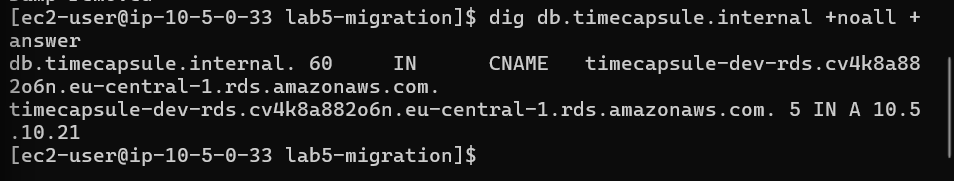

В приложении сохранено значение `DB_HOST=db.timecapsule.internal`. Для PHP с `pdo_pgsql` используется автоматическое согласование TLS с RDS; параметры для Node.js не добавлялись. PHP-FPM перезагружен командой `sudo systemctl reload php-fpm`.

После переключения проверен endpoint `/health`, который вернул успешное состояние. Через интерфейс приложения создана капсула `LR5-RDS-switch`, затем её наличие проверено прямым запросом к RDS:

```sql
SELECT id, title, created_at
FROM public.capsules
WHERE title = 'LR5-RDS-switch'
ORDER BY id DESC;
```

Получен результат:

| id | title | created_at |
|---:|---|---|
| 11 | `LR5-RDS-switch` | `2026-11-03 15:34:32.509712` |

Наличие новой капсулы в RDS подтверждает, что приложение записывает данные в перенесённую базу.

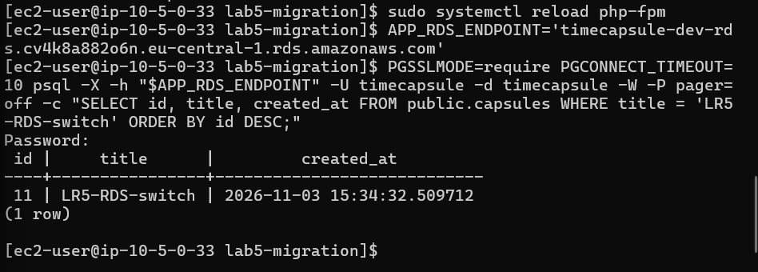

Старый `db-server` остановлен, после чего повторная проверка `/health` подтвердила работоспособность приложения. Затем старый экземпляр базы завершён; на скриншоте EC2 он отображается со статусом `Terminated`, а `app-server` и bastion — со статусом `Running`. Приложение больше не зависит от PostgreSQL на прежнем EC2.

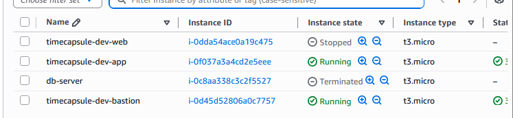

### Почему не пришлось менять DB_HOST?

Приложение использует постоянное приватное имя `db.timecapsule.internal`, которое скрывает конкретное размещение базы. После замены A-записи на CNAME это имя стало приводить к endpoint RDS. Изменение адреса назначения выполнено на уровне DNS, поэтому настройки хоста приложения сохранились.

### Какие обязанности из ЛР3 перешли к AWS, а какие остались за нами?

AWS обслуживает инфраструктуру и ОС базы, предоставляет механизм обновлений RDS, автоматических резервных копий и восстановления на момент времени. За нами остаются сетевые ограничения, пользователи, пароли, схема и данные приложения. Мы выбираем параметры обслуживания и резервного копирования, выполняем переключение приложения и проверяем восстановление. Мониторинг состояния, контроль расходов и запуск базы перед занятиями также остаются нашей ответственностью.

---

## Задание 11. Обслуживание базы

Для проверки поведения приложения при обслуживании RDS выполнена перезагрузка экземпляра `timecapsule-dev-rds`. Во время проверки запросы к `/health` отправлялись из локального PowerShell:

```powershell
curl.exe -i --max-time 15 "http://<Elastic-IP-приложения>/health"
```

На скриншоте зафиксированы два последовательных результата:

| Время по HTTP-заголовку Date, UTC | HTTP-код | Ответ приложения |
|---|---|---|
| `2026-11-03 15:58:16` | `200 OK` | `status: ok`, `db: ok` |
| `2026-11-03 15:58:42` | `500 Internal Server Error` | `status: error`, `db: error` |

При недоступной базе ответ содержал подсказку `Cannot connect to the database. Check DB_HOST, DB_PORT, DB_NAME, DB_USER and DB_PASSWORD.` Веб-сервер продолжал отвечать, но приложение не могло установить соединение с PostgreSQL. Интервал между этими запросами не является измеренной продолжительностью простоя.

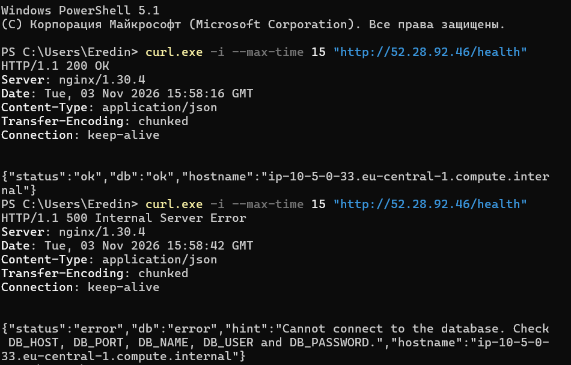

Также проверен повторный вызов остановки через EventBridge Scheduler. В CloudTrail найдено событие со следующими фактическими параметрами:

| Поле | Значение |
|---|---|
| `eventTime` | `2026-11-03T16:50:22Z` — 18:50:22 по времени Кишинёва |
| `eventName` | `StopDBInstance` |
| `eventSource` | `rds.amazonaws.com` |
| Регион | `eu-central-1` |
| Тип инициатора | `AssumedRole` |
| Роль выполнения | `timecapsule-dev-scheduler-role` |
| Целевой экземпляр | `timecapsule-dev-rds` |
| `errorCode` | `InvalidDBInstanceStateFault` |

Сообщение ошибки:

```text
Instance timecapsule-dev-rds is not in available state.
```

В поле `userAgent` указан `AmazonEventBridgeScheduler`, а сведения о принятой роли подтверждают вызов от имени расписания. Повторная остановка отклонена из-за состояния экземпляра, а не из-за недостатка прав роли. Номер аккаунта на скриншоте скрыт.

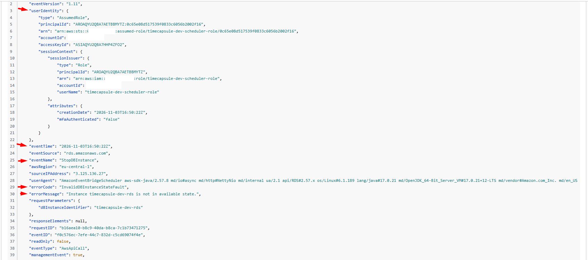

При полностью остановленной базе приложение выдавало ошибку. После `Start → Available` приложение и `/health` снова работали успешно, без изменения конфигурации. Расписанию возвращено выражение `0 23 * * ? *`, часовой пояс `Europe/Chisinau`.

### Что показывал health во время перезагрузки?

Во время недоступности базы `/health` вернул HTTP 500 с полями `status: error` и `db: error`. В ответе также появилась подсказка об ошибке подключения к базе. Успешный запрос перед этим вернул HTTP 200 и состояние `ok`.

### Изменился ли endpoint после остановки и запуска?

После остановки и повторного запуска endpoint остался прежним: `timecapsule-dev-rds.cv4k8a882o6n.eu-central-1.rds.amazonaws.com`. Поэтому изменять CNAME и `DB_HOST` приложения не потребовалось.

### Какую ошибку получает расписание, если база уже остановлена?

При проверке повторной остановки в CloudTrail зафиксирован код `InvalidDBInstanceStateFault` и сообщение `Instance timecapsule-dev-rds is not in available state.` Операция не выполняется, потому что экземпляр не находится в состоянии, допускающем остановку. Права роли Scheduler при этом не являются причиной ошибки.

---

## Задание 12. Архитектура и решение

Обновлена схема из ЛР4: база приложения размещена в приватной RDS PostgreSQL 18.3 Single-AZ в `eu-central-1a`, а прежний EC2 `db-server` удалён. Вложения по-прежнему находятся в приватном S3; доступ приложения обеспечивается IAM-ролью, скачивание — подписанными URL.

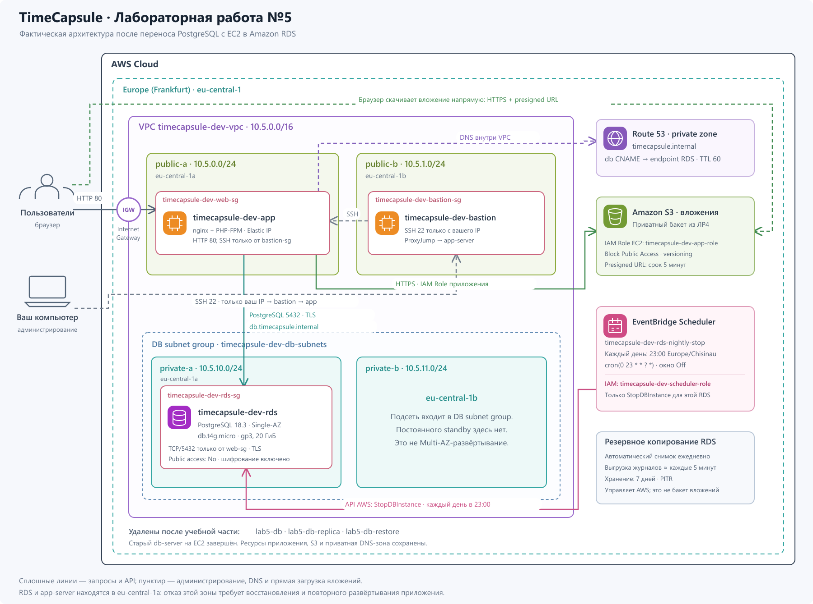

[Редактируемая схема SVG](./images/ex12_architecture.svg).

В схеме показаны VPC `10.5.0.0/16`, четыре подсети, app-server, bastion, группы доступа, приватная CNAME-запись Route 53 и Scheduler с отдельной IAM-ролью. `private-b` входит в группу подсетей базы, но постоянного резервного экземпляра там нет. Учебные базы Части 1 отмечены как удалённые.

Решение зафиксировано в [ADR-0004 — Размещение базы приложения в Amazon RDS](../adr/0004-database-hosting.md). Сравнены PostgreSQL на EC2, RDS Single-AZ, RDS Multi-AZ и Amazon Aurora. В последствиях описаны резервное копирование и возможная потеря последних изменений, стоимость, ночная остановка, автоматический запуск после 7 суток и восстановление при отказе зоны.

По проверенному прайс-листу AWS для Frankfurt базовая оценка выбранной RDS составляет $16.61 в месяц при 730 часах работы и 20 ГиБ gp3: `$0.019 × 730 + $0.137 × 20`. При остановке сохраняется плата за выделенное хранилище. Расчёт не включает дополнительные расходы, налоги и применение кредитов.
---

## Контрольные вопросы для устной защиты

Письменные ответы на вопросы отдельных заданий приведены в соответствующих разделах выше. Ниже подготовлены дополнительные ответы для продвинутого уровня на основе фактической архитектуры проекта.

### 1. Как проходит запрос от браузера до базы и какие проверки выполняются?

Браузер отправляет HTTP-запрос на Elastic IP приложения: через Internet Gateway и маршруты публичной подсети он поступает на EC2, где трафик фильтруют Network ACL и `timecapsule-dev-web-sg`, разрешающая порт 80. nginx передаёт PHP-запрос в PHP-FPM, а код приложения для соответствующего маршрута проверяет сессию, права доступа к капсуле и CSRF-токен изменяющей формы. PHP через PDO разрешает `db.timecapsule.internal` в приватной зоне Route 53, получает через CNAME endpoint RDS и подключается по TCP/5432 с TLS; `timecapsule-dev-rds-sg` допускает этот трафик только от группы приложения, а PostgreSQL проверяет пароль и права пользователя `timecapsule`. Результат запроса возвращается через PHP-FPM и nginx в браузер; TLS к базе не означает, что текущий HTTP-доступ браузера к приложению тоже зашифрован.

### 2. Чем репликация отличается от резервного копирования?

Репликация поддерживает актуальную копию базы и применяется для масштабирования чтения или повышения доступности в зависимости от выбранной конфигурации. Read replica RDS PostgreSQL получает изменения асинхронно и может отставать, но ошибочный `DELETE` также будет передан на неё. Резервные копии и журналы транзакций позволяют восстановить прошлое состояние на отдельном экземпляре с помощью PITR. В лабораторной реплика повторила удаление строк, а восстановление на момент до удаления вернуло все четыре строки `notes`.

Справка: [read replicas](https://docs.aws.amazon.com/AmazonRDS/latest/UserGuide/USER_ReadRepl.html), [восстановление на момент времени](https://docs.aws.amazon.com/AmazonRDS/latest/UserGuide/USER_PIT.html).

### 3. Как пережить отказ eu-central-1a и сколько это будет стоить?

Сейчас в `eu-central-1a` находятся и Single-AZ база, и `app-server`, поэтому восстановление потребует поднять RDS из резервной копии и развернуть приложение в доступной зоне `eu-central-1b`, обновить CNAME и переназначить Elastic IP. Для автоматического переживания отказа нужны RDS Multi-AZ либо подходящий кластер Aurora, а также серверы приложения в двух зонах за балансировщиком. Наша Single-AZ RDS оценена в **$16.61/месяц** при работе 24/7, а грубый ориентир для Multi-AZ — около **$33/месяц только за базу**, если для предварительного планирования удвоить текущую стоимость вычислений и хранилища; это расчётный ориентир, а не отдельно проверенный тариф Multi-AZ. Дополнительный EC2, балансировщик, адреса и трафик оплачиваются отдельно, поэтому точную стоимость всей отказоустойчивой архитектуры нужно рассчитывать по её конкретным параметрам.

Справка: [RDS Multi-AZ](https://docs.aws.amazon.com/AmazonRDS/latest/UserGuide/Concepts.MultiAZSingleStandby.html), [проверенные ставки выбранной Single-AZ базы в ADR-0004](../adr/0004-database-hosting.md#стоимость-и-ограничение-расходов).

### 4. Как решена проблема автоматического запуска базы через 7 дней?

Создано ежедневное расписание EventBridge Scheduler с выражением `0 23 * * ? *` и часовым поясом `Europe/Chisinau`, которое вызывает `StopDBInstance` через роль с правом остановки только нашей базы. Штатный запуск AWS после семи суток остановки не отменяется: расписание должно снова остановить запущенный экземпляр в ближайшие 23:00, а до этого за вычисления начисляется плата. Если база уже остановлена, повторный вызов возвращает зафиксированную в CloudTrail ошибку `InvalidDBInstanceStateFault`, а перед следующим занятием база запускается вручную. Состояние экземпляра и результат вызовов нужно проверять, поскольку расписание не является жёстким лимитом расходов, а хранение данных оплачивается и при остановленной базе.

Справка: [остановка, автоматический запуск и тарификация RDS](https://docs.aws.amazon.com/AmazonRDS/latest/UserGuide/USER_StopInstance.html).

---

## Завершение работы

Учебные экземпляры `lab5-db`, `lab5-db-replica`, `lab5-db-restore`, группа подсетей `lab5-db-subnets` и учебные Security Groups удалены при завершении Части 1. Старый EC2 `db-server` завершён после проверки работы приложения с RDS.

Сохраняются `timecapsule-dev-rds`, `timecapsule-dev-db-subnets`, `timecapsule-dev-rds-sg`, политика и роль Scheduler, включённое ночное расписание, ресурсы приложения, приватная DNS-зона и S3. В начале следующего занятия сначала запускается RDS, затем необходимые EC2-серверы.

**Финальная проверка:** остановить `timecapsule-dev-rds` и дождаться статуса `Stopped`. На момент подготовки этого раздела завершение остановки ещё не подтверждено.

**Перед публикацией:** скрыть номер аккаунта в поле `Owner` на `images/ex1_db-sg.png` и внутри ARN на `images/ex1_db-subnets.png`. В этих двух сохранённых изображениях он пока виден; пароли и `.env` в отчёт не включены.

