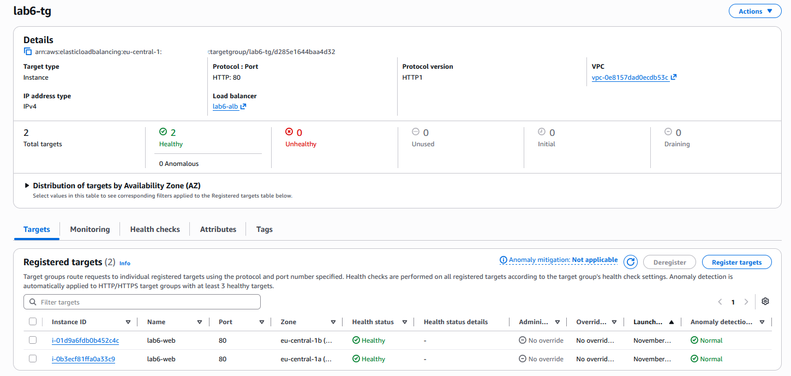
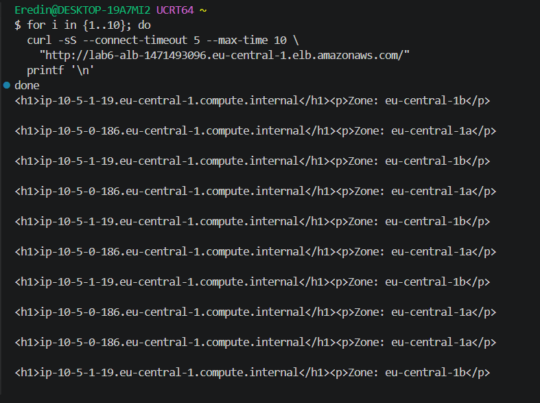
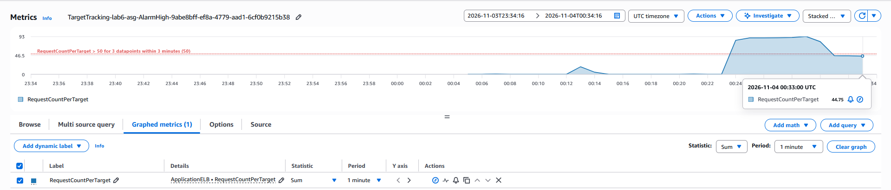
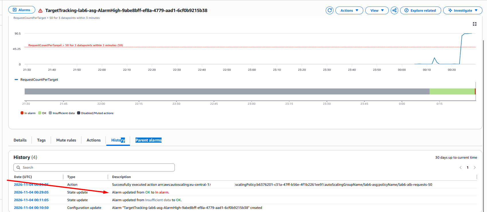
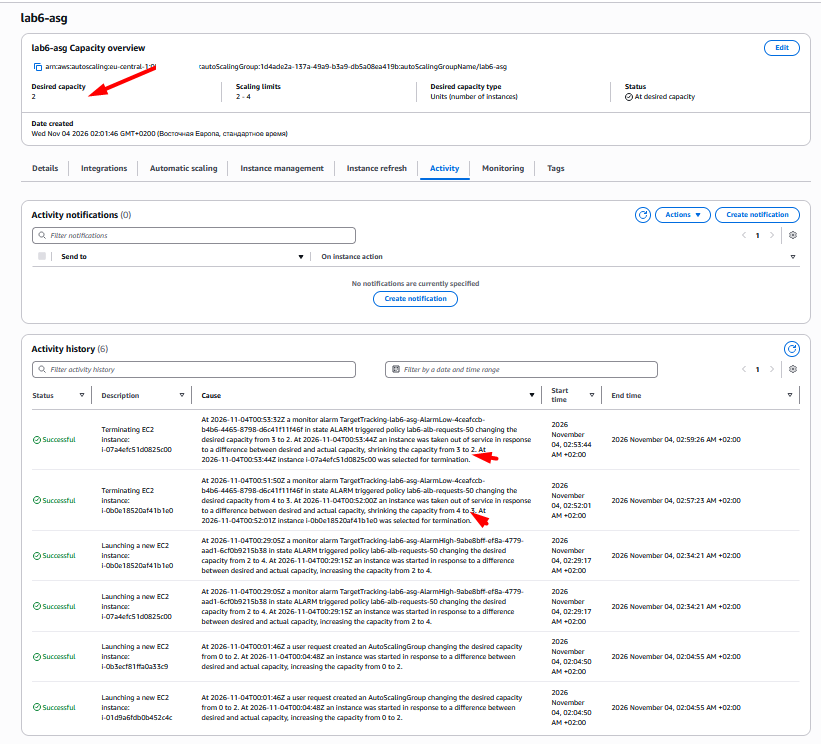
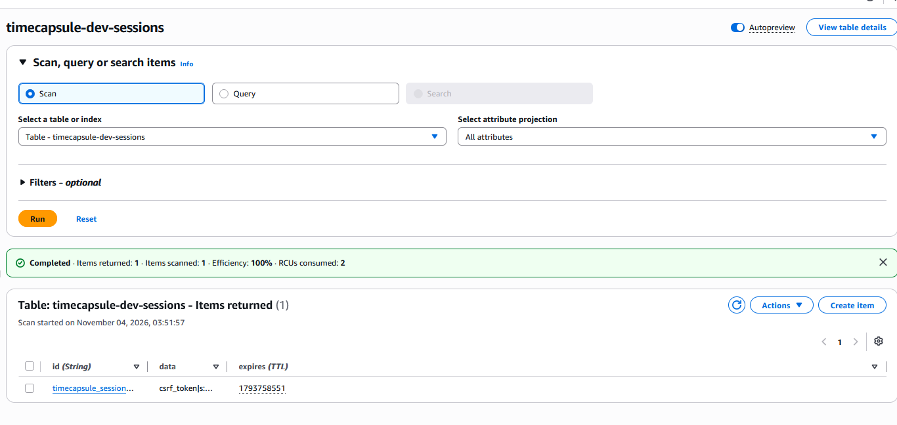
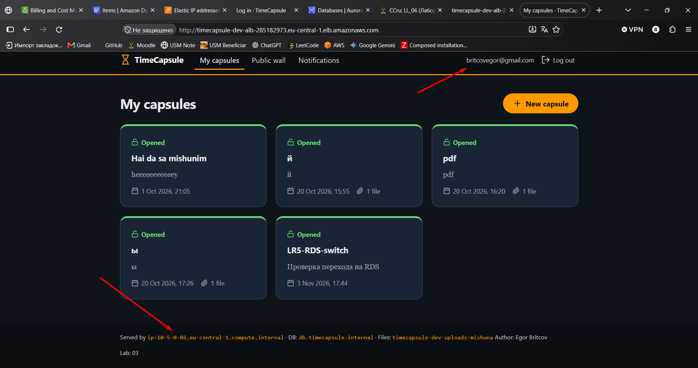
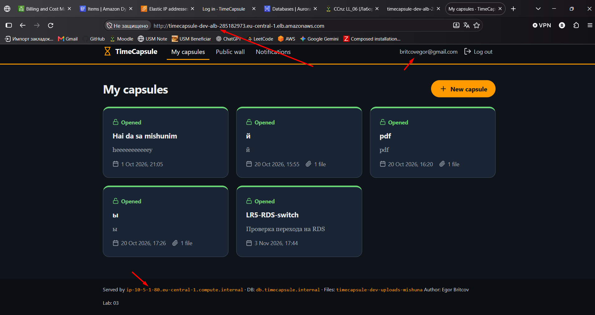
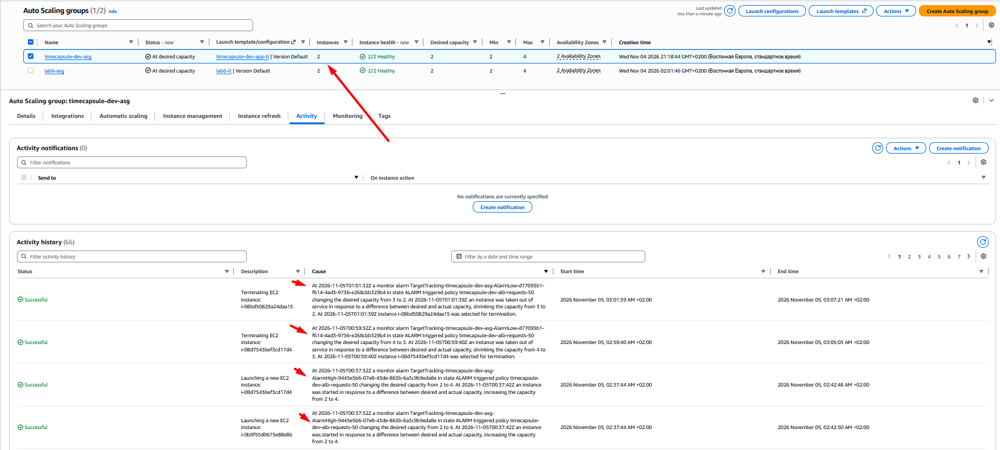
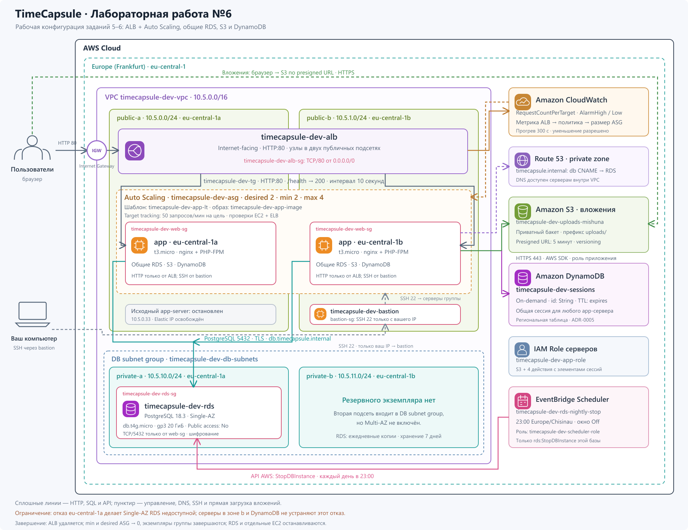

# Лабораторная работа №6
## Дисциплина: Cloud Computing
## Масштабирование и балансировка нагрузки. Elastic Load Balancing, Amazon EC2 Auto Scaling
## Выполнил: Бритков Егор, Informatica, I2402
## Выбранный уровень: Продвинутый
## Репозиторий: https://github.com/eredin-cloud/timecapsule

**Цель работы:** научиться распределять запросы между серверами с помощью Application Load Balancer и автоматически изменять их количество с помощью Amazon EC2 Auto Scaling. Запустить приложение на нескольких серверах с общим хранилищем пользовательских сессий в DynamoDB.

---

## Задание 1. Балансировщик

В регионе `eu-central-1`, в существующей VPC `timecapsule-dev-vpc` из ЛР3, созданы целевая группа `lab6-tg` и Application Load Balancer `lab6-alb`. Учебным ресурсам назначен тег `Lab = lab6`.

### Целевая группа

| Параметр | Значение |
|---|---|
| Имя | `lab6-tg` |
| Тип целей | `Instances` |
| Протокол и порт | HTTP, 80 |
| Путь проверки работоспособности | `/health` |
| Интервал проверки | 10 секунд |
| Ожидаемый код ответа проверки | `200` |

На этом этапе серверы в целевой группе отсутствуют. Их запустит группа Auto Scaling в задании 2.

### Балансировщик

| Параметр | Значение |
|---|---|
| Имя | `lab6-alb` |
| Тип | Application Load Balancer |
| Схема | `Internet-facing` |
| Тип IP-адресов | IPv4 |
| Подсеть в `eu-central-1a` | `timecapsule-dev-public-a`, `10.5.0.0/24` |
| Подсеть в `eu-central-1b` | `timecapsule-dev-public-b`, `10.5.1.0/24` |
| Security Group | `lab6-alb-sg` |
| Входящее правило Security Group | HTTP, TCP/80, источник `0.0.0.0/0` |
| Listener | HTTP:80 → `lab6-tg` |

Балансировщик проверен в браузере по адресу:

```text
http://lab6-alb-1471493096.eu-central-1.elb.amazonaws.com/
```

Получен ответ:

```text
503 Service Temporarily Unavailable
```

**Результат:** балансировщик принимает HTTP-запросы по своему DNS-имени. Передача запросов серверам будет проверена после создания группы Auto Scaling; сейчас целевая группа пуста.

### Какой ответ вернул балансировщик и почему?

Балансировщик вернул HTTP `503 Service Temporarily Unavailable`. В целевой группе пока нет зарегистрированных серверов, поэтому передать запрос некому. Такой ответ ожидаем до запуска серверов в задании 2.

### Зачем балансировщику подсети в двух зонах?

Для регионального Application Load Balancer AWS требует выбрать подсети минимум в двух зонах доступности. Узлы балансировщика размещаются в разных зонах, что повышает устойчивость к отказу одной из них. Для сохранения доступности всего приложения также нужны работающие серверы в доступной зоне; их размещение настроим в задании 2.

---

## Задание 2. Группа Auto Scaling

Создан шаблон запуска `lab6-lt` для Amazon Linux 2023, тип экземпляра — `t3.micro`, с существующей парой SSH-ключей. Подсеть в шаблоне не задана: размещение экземпляров определяет группа Auto Scaling. Скрипт User data устанавливает и запускает nginx, записывает имя сервера и его зону доступности на главную страницу, а для проверки `/health` создаёт ответ `OK`.

Для серверов используется отдельная Security Group `lab6-web-sg` с входящими правилами:

| Протокол и порт | Источник | Назначение |
|---|---|---|
| TCP/80 | `lab6-alb-sg` | HTTP-запросы и проверки работоспособности от балансировщика |
| TCP/22 | `timecapsule-dev-bastion-sg` | SSH только через bastion |

Из шаблона создана группа `lab6-asg`, связанная с целевой группой `lab6-tg`. Параметры выполнения задания:

| Параметр | Значение |
|---|---|
| Подсети | `timecapsule-dev-public-a`, `timecapsule-dev-public-b` |
| Desired capacity | 2 |
| Minimum capacity | 2 |
| Maximum capacity | 4 |
| Проверки работоспособности | EC2 и Elastic Load Balancing |
| Health check grace period | 300 секунд |

**Политика масштабирования:** настроена target tracking с метрикой `Application Load Balancer request count per target`, целевой группой `lab6-tg` и значением `50` запросов в минуту на сервер. Уменьшение группы разрешено (`Disable scale in` выключен). Работа масштабирования под нагрузкой проверена в задании 3.

### Проверка целей и распределения запросов

Оба экземпляра зарегистрированы в `lab6-tg` на порту 80 и находятся в состоянии `healthy`. На скриншоте целевой группы видны две исправные цели, по одной в каждой зоне доступности.



В локальном Git Bash выполнено десять последовательных запросов к DNS-имени балансировщика:

```bash
for i in {1..10}; do
  curl -sS --connect-timeout 5 --max-time 10 \
    "http://lab6-alb-1471493096.eu-central-1.elb.amazonaws.com/"
  printf '\n'
done
```

В ответах получены данные двух разных серверов:

| Имя сервера | Зона доступности |
|---|---|
| `ip-10-5-0-186.eu-central-1.compute.internal` | `eu-central-1a` |
| `ip-10-5-1-19.eu-central-1.compute.internal` | `eu-central-1b` |



**Результат проверки:** вместо HTTP 503 балансировщик возвращает страницы nginx от двух серверов из разных зон доступности. Обе цели успешно проходят проверки работоспособности.

### Чем группа Auto Scaling отличается от целевой группы?

Группа Auto Scaling управляет жизненным циклом EC2: запускает экземпляры, заменяет неисправные и изменяет их количество в заданных пределах. Целевая группа хранит цели, на которые балансировщик направляет запросы, и параметры проверки их работоспособности. При связи этих групп Auto Scaling автоматически регистрирует запускаемые экземпляры в целевой группе и снимает их с регистрации при завершении работы.

### Почему в шаблоне нет подсети?

Шаблон описывает конфигурацию сервера, а подсети для его размещения задаются в группе Auto Scaling. Благодаря этому один шаблон применяется для запуска экземпляров в обеих зонах доступности. Выбор подсетей в группе позволяет распределять серверы между `eu-central-1a` и `eu-central-1b` без создания отдельных шаблонов.

---

## Задание 3. Нагрузка

С локального компьютера, в Git Bash, запущены последовательные HTTP-запросы к балансировщику в течение десяти минут:

```bash
ALB="lab6-alb-1471493096.eu-central-1.elb.amazonaws.com"

echo "Load started:"
date -Is

end=$((SECONDS + 600))
while [ "$SECONDS" -lt "$end" ]; do
  curl -s --connect-timeout 5 --max-time 10 \
    -o /dev/null "http://$ALB/"
done

echo "Load finished:"
date -Is
```

### Результаты наблюдений

| Показатель | Результат |
|---|---|
| Начало нагрузки | `2026-11-04T02:24:04+02:00` |
| Окончание нагрузки | `2026-11-04T02:34:04+02:00` |
| Продолжительность | 10 минут |
| Исходное количество серверов | 2 |
| Максимальное количество серверов | 4: запущены 2 дополнительных экземпляра |
| Количество серверов после снижения нагрузки | 2 |

В CloudWatch наблюдалась метрика `RequestCountPerTarget` со статистикой `Sum` и периодом `1 minute`. Во время нагрузки она поднялась примерно до 90 запросов в минуту на цель, превысив целевое значение 50. После подключения дополнительных серверов на графике видно снижение; в точке `00:33 UTC` (`02:33 UTC+02:00`) значение составляет `44.75` запроса на цель за минуту, при этом скрипт нагрузки ещё работал.



На вкладке History тревоги `AlarmHigh` зафиксирован переход из `OK` в `ALARM` в `00:29:05 UTC` (`02:29:05 UTC+02:00`) и успешный вызов политики `lab6-alb-requests-50`. На скриншоте видно условие тревоги: `RequestCountPerTarget > 50` для трёх точек в течение трёх минут.



На вкладке Activity группы `lab6-asg` зафиксированы успешные запуски двух дополнительных экземпляров. В поле Cause указано, что тревога `AlarmHigh` вызвала политику, изменившую желаемую ёмкость с 2 до 4. После завершения нагрузки сработала `AlarmLow`: желаемая ёмкость уменьшилась сначала с 4 до 3, затем с 3 до 2; лишние экземпляры завершены. Итоговое значение Desired capacity — 2, пределы группы сохранены: 2–4.



**Результат:** автоматическое увеличение и уменьшение группы проверено. Под нагрузкой количество серверов выросло с двух до четырёх, после её окончания группа автоматически вернулась к двум серверам.

### Сколько серверов запустила группа и почему не больше четырёх?

Изначально работали два сервера, а под нагрузкой группа запустила ещё два — всего стало четыре. Это соответствует настроенному пределу Maximum capacity = 4. Политика target tracking изменяет размер группы в заданных пределах, поэтому высокая нагрузка не позволяет ей превысить этот максимум.

### Почему метрика упала после запуска новых серверов, хотя запросов не стало меньше?

`RequestCountPerTarget` показывает среднее количество запросов на одну исправную цель, а не общее количество запросов к балансировщику. Когда число исправных целей выросло с двух до четырёх, запросы стали распределяться между большим количеством серверов. При неизменном общем потоке средняя нагрузка на сервер уменьшается примерно вдвое, что согласуется с наблюдаемым снижением примерно с 90 до 45 запросов в минуту на цель. Скрипт не фиксирует точную частоту запросов, поэтому значения могут колебаться.

### Почему группа добавляет серверы быстрее, чем убирает?

Быстрое увеличение ёмкости помогает сохранить доступность приложения при росте нагрузки. Перед уменьшением группа должна убедиться, что снижение спроса устойчиво, чтобы не завершить серверы при кратковременном спаде и не запускать их сразу заново. Кроме того, во время прогрева новых экземпляров target tracking блокирует уменьшение группы. Поэтому увеличение и уменьшение не происходят симметрично по времени.

---

## Задание 4. Сессии в DynamoDB

Для варианта приложения `open_capsules_php_functional` сессии перенесены из локальных файлов в общую таблицу Amazon DynamoDB. Таблица создана в регионе `eu-central-1` со следующими параметрами:

| Параметр | Значение |
|---|---|
| Имя таблицы | `timecapsule-dev-sessions` |
| Partition key | `id`, тип `String` |
| Sort key | Отсутствует |
| Режим ёмкости | `On-demand` |
| TTL | Включён для атрибута `expires` |
| Тег | `Lab = lab6` |

Создана политика `timecapsule-dev-app-sessions`, разрешающая только `dynamodb:GetItem`, `dynamodb:PutItem`, `dynamodb:UpdateItem` и `dynamodb:DeleteItem` для этой таблицы. Политика прикреплена к существующей роли `timecapsule-dev-app-role`. AWS SDK получает временные учётные данные из роли EC2; статические ключи доступа в конфигурацию не добавлялись.

### Изменения приложения и выпуск

В серверный `.env` добавлена настройка:

```dotenv
DYNAMODB_SESSION_TABLE=timecapsule-dev-sessions
```

В `src/bootstrap.php`, внутри функции `start_session()`, вместо `session_save_path()` создаётся клиент DynamoDB и регистрируется обработчик сессий:

```php
$table = config('DYNAMODB_SESSION_TABLE');
if ($table === null) {
    throw new RuntimeException('DYNAMODB_SESSION_TABLE is not configured.');
}

$dynamoDb = new Aws\DynamoDb\DynamoDbClient([
    'region' => config('AWS_REGION', 'eu-central-1'),
    'version' => 'latest',
]);
$sessionHandler = Aws\DynamoDb\SessionHandler::fromClient($dynamoDb, [
    'table_name' => $table,
]);
$sessionHandler->register();
```

Регистрация выполняется до существующего вызова `session_start()`. Имя cookie `timecapsule_session` и её параметры сохранены. Обработчик использует атрибут `id` для ключа, `data` для содержимого сессии и `expires` для времени истечения в секундах Unix timestamp; старые элементы удаляются механизмом TTL асинхронно.

AWS SDK уже установлен для работы с S3, поэтому добавление новых зависимостей Composer не потребовалось. Изменения отправлены в репозиторий, новая версия успешно выпущена на `app-server` существующим скриптом `~/deploy.sh`.

### Проверка сессии

После выпуска выполнен вход под существующим пользователем. В Explore table items таблицы `timecapsule-dev-sessions` найден элемент сессии: на скриншоте видны ключ `id` типа String, данные `data` и атрибут `expires`, помеченный как TTL. Вход работает, включение TTL подтверждено.



**Результат:** приложение сохраняет пользовательские сессии в DynamoDB. Общее хранилище подготовлено для работы нескольких серверов; сохранение входа при переключении между серверами проверено в задании 5.

### Почему сессии нельзя оставить в файлах, когда серверов несколько?

Файл сессии находится на диске конкретного сервера и недоступен другим экземплярам. Если следующий запрос балансировщик направит на другой сервер, тот не найдёт данные входа, хотя браузер передаст ту же cookie. Общая таблица DynamoDB позволяет любому серверу получить сессию по её идентификатору, а завершение отдельного экземпляра не удаляет сессию пользователя.

### Зачем Node.js нужен `initialized: true`?

В библиотеке `connect-dynamodb` параметр `initialized: true` сообщает хранилищу, что таблица уже подготовлена, и отключает её автоматическую проверку и попытку создания. Это позволяет приложению работать с выданными правами на операции с элементами без дополнительных разрешений `DescribeTable` и `CreateTable`. В нашем варианте PHP этот параметр не применяется: обработчик AWS SDK подключается к заранее созданной таблице через `table_name`.

---

## Задание 5. Приложение в группе Auto Scaling

Из исходного `app-server` создан образ `timecapsule-dev-app-image`, содержащий установленное приложение, зависимости и серверный `.env` с настройками RDS, S3 и DynamoDB. На основе образа создан шаблон `timecapsule-dev-app-lt` для запуска экземпляров `t3.micro` с существующей парой SSH-ключей и профилем роли `timecapsule-dev-app-role`. Подсеть в шаблоне не задана, User data не требуется: приложение уже находится в образе.

### Сетевой доступ и балансировщик

Создана Security Group балансировщика `timecapsule-dev-alb-sg`, принимающая HTTP на TCP/80 из `0.0.0.0/0`. Серверы группы используют существующую `timecapsule-dev-web-sg`: входящий HTTP разрешён только от `timecapsule-dev-alb-sg`, SSH — только от `timecapsule-dev-bastion-sg`. Доступ к RDS сохранён благодаря правилу базы, разрешающему TCP/5432 от `timecapsule-dev-web-sg`. Роль приложения обеспечивает доступ к вложениям в S3 и сессиям в DynamoDB.

| Ресурс / параметр | Значение |
|---|---|
| Целевая группа | `timecapsule-dev-tg`, тип целей `Instances`, HTTP:80 |
| Проверка работоспособности | `/health`, интервал 10 секунд, успешный код `200` |
| Балансировщик | `timecapsule-dev-alb`, Application Load Balancer |
| Схема и адресация | `Internet-facing`, IPv4 |
| Подсети балансировщика и группы | `timecapsule-dev-public-a`, `timecapsule-dev-public-b` |
| Listener | HTTP:80 → `timecapsule-dev-tg` |
| Группа Auto Scaling | `timecapsule-dev-asg` |
| Шаблон запуска | `timecapsule-dev-app-lt` |
| Desired / Minimum / Maximum capacity | 2 / 2 / 4 |
| Проверки Auto Scaling | EC2 и Elastic Load Balancing |
| Health check grace period | 300 секунд |
| Политика target tracking | `Application Load Balancer request count per target`, цель 50, уменьшение группы разрешено |

### Переключение и проверка входа

Приложение открыто по DNS-имени нового балансировщика:

```text
http://timecapsule-dev-alb-285182973.eu-central-1.elb.amazonaws.com/
```

После входа выполнены повторные обращения к странице My capsules. В строке Served by отображаются два разных сервера, при этом на обоих скриншотах пользователь остаётся авторизованным и видит свои капсулы:

| Сервер | Зона доступности |
|---|---|
| `ip-10-5-0-86.eu-central-1.compute.internal` | `eu-central-1a` |
| `ip-10-5-1-80.eu-central-1.compute.internal` | `eu-central-1b` |





Исходный `app-server` с приватным IP `10.5.0.33` остановлен. Его Elastic IP отвязан и освобождён. Пользовательские запросы обслуживают экземпляры группы через балансировщик.

**Результат:** приложение работает за ALB на серверах из двух зон доступности. Смена обслуживающего сервера не приводит к потере входа благодаря общему хранилищу сессий DynamoDB; данные и вложения остаются общими в RDS и S3.

### Почему Elastic IP больше не нужен?

Пользователи обращаются к DNS-имени балансировщика, который направляет запросы на текущие серверы группы. При запуске и завершении экземпляров их регистрацией в целевой группе управляет Auto Scaling, поэтому постоянный публичный адрес отдельного сервера не требуется. Освобождение Elastic IP исходного сервера также прекращает расходы на этот выделенный адрес.

### Почему у всех серверов группы одинаковые `.env` и секреты?

Все экземпляры запускаются из одного AMI, который содержит одну и ту же конфигурацию приложения вместе с `.env`. Это позволяет серверам обращаться к общей базе, бакету и таблице сессий с одинаковыми настройками независимо от того, куда попал запрос. При смене секретов нужно обновить образ и заменить экземпляры, использующие старую конфигурацию. Временные учётные данные AWS серверы получают из назначенной роли, а не из сохранённых в `.env` ключей доступа.

### Что станет с проверкой `/health`, если базу остановить?

Обработчик `/health` выполняет запрос к таблице `users`, поэтому при недоступной RDS возвращает HTTP 500 с полями `status: error` и `db: error`. После неудачных проверок ALB помечает цели как `unhealthy`, поскольку ожидает код 200. Включённые проверки ELB могут заставить Auto Scaling заменять серверы, но это не восстановит доступность приложения, пока общая база остановлена.

---

## Задание 6. Нагрузка на приложение

После входа в приложение в браузере с локального компьютера запущен скрипт нагрузки из задания 3 с адресом нового балансировщика:

```bash
ALB="timecapsule-dev-alb-285182973.eu-central-1.elb.amazonaws.com"
```

Скрипт последовательно отправлял HTTP-запросы в течение примерно десяти минут. Наблюдалась реакция группы `timecapsule-dev-asg` и её политики `timecapsule-dev-alb-requests-50`.

| Показатель | Результат |
|---|---|
| Начало нагрузки | `2026-11-05T02:32:09+02:00` |
| Окончание нагрузки | `2026-11-05T02:42:10+02:00` |
| Продолжительность по отметкам скрипта | 10 минут 1 секунда |
| Исходное количество серверов | 2 |
| Максимальное количество серверов | 4 |
| Количество после уменьшения группы | 2, обе цели исправны |
| Повторный вход при масштабировании | Не потребовался |

На вкладке Activity зафиксирована следующая последовательность событий. Время приведено в `UTC+02:00`, дата — 5 ноября 2026 года:

| Время | Событие |
|---|---|
| `02:37:32` | `AlarmHigh` вызвала политику, изменившую желаемую ёмкость с 2 до 4; запущены два дополнительных экземпляра |
| `02:59:32` | `AlarmLow` вызвала уменьшение желаемой ёмкости с 4 до 3 |
| `03:01:32` | `AlarmLow` вызвала уменьшение желаемой ёмкости с 3 до 2 |
| `03:07:21` | Завершено последнее из двух событий удаления лишних экземпляров |

На итоговом скриншоте видны две исправные машины, Desired capacity = 2, пределы 2–4 и успешные события увеличения и уменьшения группы с причинами в поле Cause. Возврат желаемой ёмкости к двум произошёл примерно через 19 минут после окончания нагрузки; завершение последнего лишнего экземпляра — примерно через 25 минут.



Пользователь оставался авторизованным при увеличении группы до четырёх серверов и после её уменьшения до двух. Во время масштабирования открывались существующие капсулы и успешно создана новая капсула `LR6-ASG-load`.

**Результат проверки масштабирования:** приложение автоматически получило два дополнительных сервера под нагрузкой, затем группа вернулась к исходному размеру. Сессия пользователя сохранилась без повторного входа.

### Пришлось ли входить заново, когда группа добавляла или удаляла серверы? Почему?

Повторно входить не пришлось ни при увеличении, ни при уменьшении группы. Браузер передаёт одну и ту же cookie с идентификатором сессии, а все серверы приложения получают её данные из общей таблицы DynamoDB. Поэтому смена обслуживающего сервера или завершение отдельного экземпляра не удаляет авторизацию пользователя.

---

## Задание 7. Архитектура и решение

Схема ЛР5 обновлена с учётом Application Load Balancer, группы Auto Scaling в двух публичных подсетях и общей таблицы сессий DynamoDB. Показаны целевая группа с проверкой `/health`, метрика CloudWatch и тревоги, профиль роли приложения, SSH через bastion, приватный DNS базы, RDS и S3. Схема отражает рабочую конфигурацию, проверенную в заданиях 5–6, до удаления балансировщика и остановки ресурсов по завершении занятия.



[Исходная схема SVG](./images/ex7_architecture.svg).

Решение о размещении сессий записано в [ADR-0005. Хранение пользовательских сессий в Amazon DynamoDB](../adr/0005-session-storage.md) по структуре ADR из ЛР2: контекст, решение, рассмотренные альтернативы и последствия. Сравнены локальные файлы с sticky sessions, таблица в RDS и DynamoDB; выбрана DynamoDB On-demand с ключом `id` и TTL `expires`. Общее хранилище сохраняет вход при смене экземпляров, а доступ через роль EC2 позволяет обойтись без статических AWS-ключей.

На схеме и в ADR отмечено ограничение: серверы приложения распределены между двумя зонами, но RDS остаётся Single-AZ в `eu-central-1a`. Отказ этой зоны делает основную базу недоступной, даже если серверы во второй зоне и таблица сессий продолжают работать.

## Дополнительные вопросы для устной защиты

### Как проходит запрос от браузера до базы и таблицы сессий?

Браузер разрешает DNS-имя ALB и отправляет HTTP-запрос на порт 80; Security Group балансировщика разрешает этот вход, а listener направляет запрос исправной цели из `timecapsule-dev-tg`. Security Group сервера принимает HTTP только от ALB, после чего nginx передаёт запрос PHP-FPM. PHP получает идентификатор из cookie и через AWS SDK обращается к DynamoDB по HTTPS, используя права роли EC2 на нужную таблицу. Для данных приложения сервер разрешает `db.timecapsule.internal` через приватную зону Route 53 в endpoint RDS и подключается к PostgreSQL по TCP/5432 с TLS; доступ проверяют Security Group базы и учётная запись `timecapsule`.

### Чем проверка балансировщика отличается от проверки группы Auto Scaling?

ALB обращается к `/health` каждые 10 секунд и по результату проверок определяет состояние целей для маршрутизации запросов. Auto Scaling использует проверки EC2 и дополнительно включённые проверки ELB, чтобы решать, какие экземпляры нужно заменить; начальный grace period составляет 300 секунд. Балансировщик сам не запускает новые серверы, а Auto Scaling управляет их жизненным циклом и поддерживает заданный размер группы.

### Что произойдёт при отказе зоны `eu-central-1a`?

ALB и серверы в `eu-central-1b` могут продолжить работу, а региональные DynamoDB и S3 не привязаны к отказавшему серверу приложения. Однако Single-AZ RDS в `eu-central-1a` станет недоступна, поэтому приложение не сможет нормально работать с данными, а `/health` начнёт возвращать ошибку. Запуск новых EC2 не устранит отказ общей базы: при затяжном отказе потребуется восстановить RDS в доступной зоне и обновить CNAME; наличие второй приватной подсети само по себе не создаёт standby. Для автоматического переключения основной базы понадобилась бы конфигурация Multi-AZ или подходящий кластер Aurora, которые в этой работе не развёрнуты.

## Завершение работы

При завершении занятия экземпляры группы уже находились в состоянии `Terminating`, поэтому перевод в Standby был недоступен. Такие экземпляры нельзя вернуть в обслуживание; финальное состояние группы проверяется после завершения операции и установки Minimum capacity = 0, Desired capacity = 0. Это соответствует [жизненному циклу EC2 Auto Scaling](https://docs.aws.amazon.com/autoscaling/ec2/userguide/ec2-auto-scaling-lifecycle.html). Данные приложения, вложения и сессии хранятся вне этих экземпляров, а код и конфигурация сохранены в AMI.

При следующем запуске сначала потребуется запустить RDS, восстановить ALB с привязкой к сохранённой целевой группе и проверить привязку политики target tracking к новому балансировщику. Затем установка Minimum capacity = 2 и Desired capacity = 2 позволит группе создать серверы из сохранённого образа и шаблона. Сохранение AMI, snapshot и остановленных отдельных EC2 не отменяет расходы на их хранилище.


